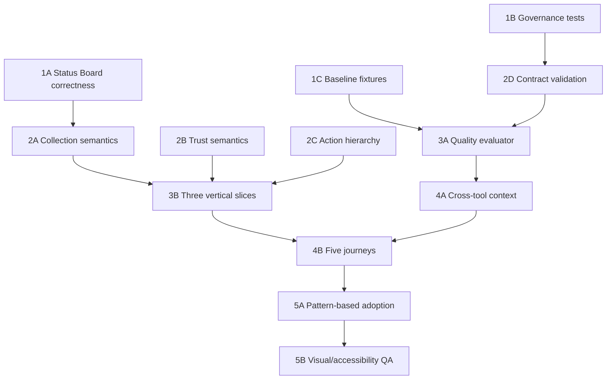

# Ask Cozy Conversational Presentation Quality & Standardization — Full Implementation Plan

**Date:** October 14, 2026

**Status:** Living implementation plan. Phases 1-3 complete; Phase 4 contract implementation complete with runtime journey validation pending; Phase 5 partially complete. Overall: substantially implemented, not fully complete (section 14.6).

**Product authority:** `docs/product/ASK_COZY_CONVERSATIONAL_PRESENTATION_QUALITY_STANDARDIZATION_FRD.md`

**Evidence:** `docs/architecture/ask-cozy/presentation-audit/`

**Implementation posture:** ContractToCozy has no production homeowners. Implement, test, review representative UX, and refine. Preserve security, authorization, confirmation, data integrity, idempotency, and current functional behavior; do not build enterprise rollout or migration machinery.

---

## 1. Objective

Extend the existing Ask Cozy operation, response-block, renderer, result-state, and action infrastructure so applicable answers consistently:

1. answer the homeowner's question first;
2. explain what materially affects the answer;
3. disclose secondary records without misleading counts or excessive density;
4. show sources, freshness, assumptions, and uncertainty where they affect trust;
5. offer the next useful authorized action when one exists; and
6. preserve entity and decision context across realistic multi-turn journeys.

This plan covers all five FRD phases. It is an implementation sequence, not a set of approval gates.

---

## 2. Non-goals

- No separate presentation engine or service.
- No LLM-selected renderer or arbitrary component payload.
- No Prisma change is expected. If implementation proves persistent state is genuinely required, update the schema and contracts but do not create migration scripts.
- No all-at-once migration of 197 operations.
- No compatibility framework for obsolete development responses.
- No generalized implementation of every item-action type.
- No replacement of the Skill Platform, operation registry, confirmation flows, or result identity model.
- No runtime environment, Docker, database, or browser-infrastructure troubleshooting solely for this work.

---

## 3. Verified architecture to preserve

| Concern | Existing authority |
|---|---|
| Operation identity, family, role floor, adapter, block allow-list | `apps/backend/src/services/ask/askOperationRegistry.ts` |
| Handler registration and policy guard | `apps/backend/src/services/ask/capabilityHandlerRegistry.ts` |
| Backend response schema | `apps/backend/src/productFramework/ask/ask.contract.ts` |
| Frontend response mirror | `apps/frontend/src/features/ask/types.ts` |
| Top-level renderer selection | `apps/frontend/src/components/ask/blocks/registry.tsx` |
| Grouped-list patterns and specialized results | `apps/frontend/src/components/ask/blocks/GroupedListBlock.tsx` and `components/ask/patterns/` |
| View/conversation/business action distinction | `apps/frontend/src/features/ask/interactionDispatch.ts` |
| Local result state | `apps/frontend/src/features/ask/resultViewState.ts`, `useResultView.ts` |
| Original/current response and result identity | `AskExecutionResponse`, execution lifecycle modules |
| Contextual suggested actions | `apps/backend/src/services/ask/suggestedActions/` |
| Cross-Skill handoff | `apps/backend/src/services/skills/skillHandoff.ts` |
| Authorization and confirmation | existing operation definitions, domain command registry, confirmation handlers |

---

## 4. Shared implementation decisions

These decisions apply across phases unless code evidence requires a simpler approach.

### 4.1 Semantic ownership

- Domain services continue to own canonical facts.
- Domain logic or governed decision services own risk, urgency, priority, and recommendation eligibility.
- Ask producers own the direct answer, rationale, presentation profile, ordering, limitations, and action nominations.
- Shared renderers own layout, disclosure, responsive transformation, keyboard/focus behavior, and local view choices.
- The client never calculates business urgency from dates, percentages, labels, or record order.

### 4.2 Proposed contract evolution

The exact names are finalized during Phase 2 after checking current producers, but the preferred minimal shape is:

```ts
type AskPresentationProfile =
  | 'DIRECT_ANSWER'
  | 'COLLECTION'
  | 'ATTENTION'
  | 'COMPARE'
  | 'GUIDE';

type AskCollectionPage = {
  sourceTotal?: number | null;
  fetchedCount: number;
  deliveredCount: number;
  nextPageAvailable: boolean;
  deliveryTruncated: boolean;
};

type AskCollectionSection = {
  id: string;
  title: string;
  count: number; // retained only if its meaning remains unambiguous
  sourceTotal?: number | null;
  deliveredCount?: number;
  initialVisibleCount?: number;
  nextOffset?: number | null;
  deliveryTruncated?: boolean;
  items: AskGroupedListItem[];
};
```

Implementation should prefer extending existing `GROUPED_LIST` sections, `TABLE.totalCount`, and current cursor/offset mechanisms over adding a new top-level block. If one shared collection object can serve both table and grouped-list shapes without making either awkward, use it; otherwise keep small shape-specific fields with identical documented semantics.

Do not persist `AskPresentationProfile` merely for taxonomy. Add it to the response contract only if producer validation or rendering cannot reliably enforce the FRD without it. A server-side quality-evaluation input may carry the profile without changing the durable response schema.

### 4.3 Compatibility posture

- Update backend and frontend mirrors together.
- Keep conservative defaults for current supported response fixtures.
- Retire obsolete development fixtures instead of adding adapters when no current dependency requires them.
- Preserve the runtime unsupported-block fallback.
- Do not create a schema-version migration system for this effort.

### 4.4 Implementation loop

For every coherent increment:

```text
Read producer and requirement
→ Add or adjust focused failing test
→ Implement smallest shared/domain change
→ Run focused backend/frontend checks
→ Review representative output
→ Correct findings
→ Update concise implementation status/backlog
```

---

## 5. Work breakdown and dependency graph



Phase 1 can begin immediately. Within Phase 2, collection semantics and trust metadata can be developed independently once the backend/frontend field names are agreed in code. Phase 3 depends on the shared contracts. Phase 4 depends on representative producers using them. Phase 5 begins only after the shared approach works across all five journeys.

---

## 6. Phase 1 — Correctness and baseline

### 6.1 Outcomes

- Status Board never presents unknown condition as Good.
- Registry governance checks reflect the live registry without recurring hard-coded drift.
- Source-reading tests understand the decomposed orchestrator.
- The first three representative slices have deterministic baseline fixtures and screenshots or static render artifacts.
- Known collection-count defects in those slices are recorded or corrected before shared-contract work.

### 6.2 Work item 1A — Status Board UNKNOWN/GOOD correction

#### Current defect

`homeStatusBoard.service.ts` exposes `dataStatus: 'UNKNOWN'` and excludes missing-date items from `summary.good`. `statusBoard.handler.ts` rebuilds counts and sections from `condition`, so an unknown item may appear in both Good and the frontend-derived Missing info group.

#### Files and symbols

- `apps/backend/src/services/ask/handlers/statusBoard.handler.ts`
  - `STATUS_BOARD_CONDITIONS`
  - `statusBoardFromView`
  - `statusBoardCaptureFields`
- `apps/backend/src/services/homeStatusBoard.service.ts`
  - `computeDataStatus`
  - `listBoard` result mapping and `summary`
- `apps/frontend/src/components/ask/patterns/StatusAccordionView.tsx`
- `apps/frontend/src/features/ask/types.ts`
- `apps/backend/src/productFramework/ask/ask.contract.ts` only if a typed UNKNOWN section signal is needed

#### Implementation

1. Treat missing-information/UNKNOWN as a mutually exclusive presentation category in the Ask producer.
2. Prefer a real server-authored `Missing information` section to the renderer synthesizing a second collection from `needsInfo`.
3. Build summary counts from the service summary or one shared classification pass; do not independently count Good with `condition === 'GOOD'`.
4. Keep the existing Add install date action on exact `INVENTORY_ITEM` identity.
5. Keep contributor/owner correction and refresh commands unchanged.
6. Preserve the estimated-condition boundary.
7. Remove client-side duplication logic after the server declares the category, unless needed temporarily within the same commit for fixture compatibility.

#### Tests

- Extend `apps/backend/tests/ask/statusBoardCapabilitySlice.test.js` with:
  - unknown item excluded from Good count and section;
  - unknown item included once in Missing information;
  - mixture of unknown, Good, Monitor, and Needs action;
  - zero known-good items does not produce an all-clear;
  - exact correction action remains.
- Extend `apps/frontend/src/components/ask/__tests__/displayPatterns.test.tsx` or add a focused `statusAccordion` test:
  - mutually exclusive tabs/sections;
  - correct accessible count;
  - keyboard tab/accordion behavior remains;
  - missing item action remains reachable.
- Keep `apps/backend/tests/ask/statusBoardCommands.test.js` green.

### 6.3 Work item 1B — Governance drift corrections

#### Files

- `apps/backend/tests/ask/askGovernance.test.js`
- `apps/backend/tests/helpers/askOrchestratorSources.js`
- `apps/backend/src/services/ask/askOperationRegistry.ts`
- `apps/backend/src/services/ask/askDomainCommandRegistry.ts`
- `apps/backend/src/services/ask/handlers/capitalPlanning.handler.ts`

#### Implementation

1. Replace stale exact assertions for 142 operations and 63 material commands.
2. Prefer derived invariants:
   - registry is non-empty;
   - every union/definition/coverage entry agrees;
   - every material command has required policy metadata;
   - handler and confirmation coverage validators return no issues.
3. Retain an exact count only if it detects a meaningful omission that type and registry validation cannot; if retained, update it with an explicit reason.
4. Change the capital-timeline source assertion to read the handler source through the existing decomposition-aware helper instead of the facade.
5. Do not weaken security or confirmation assertions to make the suite pass.

#### Tests

- Run `tests/ask/askGovernance.test.js` alone.
- Run registry/coverage suites:
  - `askInteractionCoverageMatrix.test.js`
  - `capabilityHandlerRegistry.test.js`
  - `confirmCapabilityHandlerRegistry.test.js`
  - `askTrustArchitecture.test.js`

### 6.4 Work item 1C — Baseline fixtures and practical UX evidence

#### Representative slices

1. Status Board.
2. HVAC repair/replace or refinance comparison. Prefer HVAC if it offers deterministic fixtures without external-rate setup; use refinance where its existing pure fixtures give better financial trust coverage.
3. Maintenance status plus seasonal care.

#### Files to inspect/reuse

- Backend:
  - `handlers/statusBoard.handler.ts`
  - `handlers/hvacDecision.handler.ts`, `decisionThreadPresentationBlocks.ts`, or `handlers/refinance.handler.ts`
  - `handlers/maintenance.handler.ts`
  - `support/seasonalHomeCare.ts`, `handlers/seasonalHomeCare.handler.ts`
- Frontend:
  - block/pattern components already used by these results
  - existing Ask acceptance fixture page and E2E fixtures
  - component tests under `components/ask/__tests__`

#### Implementation

1. Add stable fixture builders for the response shapes if existing fixtures are not reusable.
2. Capture baseline outputs for:
   - ordinary result;
   - missing/partial data;
   - empty state;
   - large result;
   - narrow mobile and desktop layout when the existing fixture harness supports it.
3. Do not start services or configure a new browser environment. If existing fixture E2E is unavailable, record component/static evidence and defer actual browser screenshots to Phase 3.
4. Record known limitations in a concise backlog section in this plan or the existing audit, not a formal exception register.

### 6.5 Phase 1 validation

Backend, from `apps/backend`:

```bash
node --test \
  tests/ask/statusBoardCapabilitySlice.test.js \
  tests/ask/statusBoardCommands.test.js \
  tests/ask/askGovernance.test.js \
  tests/ask/askInteractionCoverageMatrix.test.js \
  tests/ask/capabilityHandlerRegistry.test.js \
  tests/ask/confirmCapabilityHandlerRegistry.test.js
npm run typecheck
```

Frontend, from `apps/frontend`:

```bash
npx jest --runInBand \
  src/components/ask/__tests__/displayPatterns.test.tsx \
  src/features/ask/__tests__/interactionDispatch.test.ts \
  src/features/ask/__tests__/resultViewState.test.ts
npx tsc --noEmit
```

Adjust exact test paths to the focused files actually changed. Do not run broad suites merely for ceremony; expand when shared code changes justify it.

### 6.6 Phase 1 completion check

- Status Board UNKNOWN/GOOD regression is covered and fixed.
- Governance suite passes without reducing its safeguards.
- No production code outside the affected paths changes unintentionally.
- Baseline evidence exists for all three slices.
- Remaining Phase 1 limitations are prioritized.

---

## 7. Phase 2 — Shared presentation contracts

### 7.1 Outcomes

- Collection counts have one honest vocabulary.
- Material recommendations can declare basis, freshness, uncertainty, and rationale consistently.
- Action hierarchy is explicit without moving business logic to the client.
- Three producers adopt the shared semantics without new block-id workarounds.

### 7.2 Work item 2A — Collection semantics

#### Files and symbols

- `apps/backend/src/productFramework/ask/ask.contract.ts`
  - grouped-list section schema
  - `TABLE` schema
  - response/block schemas
- `apps/frontend/src/features/ask/types.ts`
- `apps/frontend/src/components/ask/blocks/GroupedListBlock.tsx`
- `apps/frontend/src/components/ask/blocks/TableBlock.tsx`
- `apps/frontend/src/features/ask/resultViewState.ts`
- `apps/frontend/src/features/ask/useResultView.ts`
- `apps/backend/src/services/ask/execution/executeOperation.ts`
- Collection producers:
  - `handlers/statusBoard.handler.ts`
  - `handlers/inventory.handler.ts`
  - `handlers/documents.handler.ts`
  - `handlers/maintenance.handler.ts`
  - `handlers/homeEventRadar.handler.ts`

#### Implementation sequence

1. Inventory current paging models:
   - local `initialVisibleCount` disclosure;
   - offset-based collection continuation;
   - cursor-based Radar continuation;
   - `TABLE.totalCount`;
   - section `count` with sliced `items`.
2. Choose the smallest fields that distinguish source, fetched, delivered, visible, and next-page state.
3. Add Zod validation and frontend mirror types together.
4. Add renderer copy/controls:
   - “Showing X of Y” only when Y is the relevant known total;
   - “Show N more” only for delivered-but-hidden rows;
   - “Load more” or equivalent only when an authoritative next request exists;
   - limitation text when delivery is bounded and no inline retrieval is supported.
5. Preserve `viewState.resultId`, `collectionOffsets`, revision, original response, and refresh semantics.
6. Migrate Status Board first, then one offset collection and one cursor collection. Recommended:
   - Status Board;
   - Inventory or Documents;
   - Home Event Radar.
7. Migrate Maintenance only after confirming its specialized priority-stack batching uses the same meanings.

#### Tests

- Backend schema acceptance/rejection for valid and contradictory count combinations.
- Producer tests at 0, 1, 5, 20, 50, and 100+.
- Frontend tests distinguishing Show more versus Load more.
- Result-state tests for local visibility versus server offset/cursor.
- Refresh/refinement tests preserving original response and stable result identity.

### 7.3 Work item 2B — Trust and rationale semantics

#### Preferred approach

Reuse existing blocks before adding fields:

- `EVIDENCE` for claim-linked sources;
- `ASSUMPTIONS` for material decision assumptions;
- `LIMITATION`/`BOUNDARY` for uncertainty and scope;
- `WHY_NOW` for timing/rationale;
- `SUMMARY` support line/chips for compact basis where already supported.

Add a new shared field only when at least two initial producers cannot express a requirement without brittle prose or block IDs.

#### Files

- `apps/backend/src/productFramework/ask/ask.contract.ts`
- `apps/frontend/src/features/ask/types.ts`
- `apps/backend/src/services/ask/decisionThreadPresentationBlocks.ts`
- `apps/frontend/src/components/ask/blocks/ContextualBlocks.tsx`
- `apps/frontend/src/components/ask/blocks/DecisionBlocks.tsx`
- `apps/frontend/src/components/ask/blocks/CoreBlocks.tsx`
- Producer handlers for HVAC/refinance and Status Board.

#### Implementation

1. Define a producer checklist for material outputs:
   - recommendation/conclusion;
   - concise rationale;
   - basis/as-of or freshness;
   - assumptions;
   - uncertainty/limitation;
   - source mapping where a claim depends on evidence.
2. Add a pure validator/evaluator under `apps/backend/src/services/ask/presentation/` only if existing answer-trust validators cannot express these checks cleanly. Suggested module:
   - `presentationQuality.contract.ts` for evaluation inputs and issue codes;
   - no execution side effects and no persistence.
3. Do not reject simple low-risk answers for lacking an evidence block.
4. Apply stricter checks only to declared material decision fixtures/operations.
5. Keep raw confidence values internal; render governed labels/copy.

### 7.4 Work item 2C — Action hierarchy

#### Files

- `apps/backend/src/productFramework/ask/ask.contract.ts`
- `apps/backend/src/services/ask/suggestedActions/finalizeSuggestedNextActions.ts`
- `suggestedNextActionCandidate.ts`, `suggestedNextActionRanking.ts`, `suggestedNextActionDeduplication.ts`
- `apps/frontend/src/components/ask/workspace/ExecutionCard.tsx`
- `apps/frontend/src/components/ask/blocks/context.tsx`
- `apps/frontend/src/features/ask/interactionDispatch.ts`

#### Implementation

1. Preserve server-declared `PRIMARY`, `SECONDARY`, and `QUIET` styles.
2. Add a quality check that normal answers have no more than one visible primary action across the immediate response surface, except explicit confirmation/balanced-choice/emergency cases.
3. Ensure contextual `CONTINUE` actions precede generic discovery.
4. Consolidate overflow actions in shared UI when multiple secondary actions create clutter.
5. Do not implement unsupported interaction types unless one of the five journeys requires them.
6. Confirm every business action still supplies registered operation and target identity and passes existing authorization/confirmation.

### 7.5 Work item 2D — Profile/result-shape validation

#### Decision point

Start with an evaluator input inferred from the fixture/producer test, not a persisted response field. Add `presentationProfile` to the response only if runtime behavior needs it for renderer selection or contract validation.

#### Suggested modules

- `apps/backend/src/services/ask/presentation/presentationQuality.contract.ts`
- `apps/backend/src/services/ask/presentation/evaluatePresentationQuality.ts`
- `apps/backend/tests/ask/presentationQualityContract.test.js`

#### Evaluator responsibilities

- `DIRECT_ANSWER`: first meaningful narrative answers or names blocker; collection optional.
- `COLLECTION`: honest collection semantics present.
- `ATTENTION`: priority and reason producer-declared; unknown not good.
- `COMPARE`: alternatives plus assumptions/limitations and recommendation rationale when present.
- `GUIDE`: objective/progress source present; no invented state.

The evaluator returns structured issues for tests and development diagnostics. It must not rewrite the result or block execution at runtime in this phase.

### 7.6 Phase 2 validation

- Backend contract and producer tests for the three adopters.
- Frontend renderer and result-state tests.
- Ask answer-trust and interaction-coverage suites.
- Backend/frontend typechecks.
- `git diff --check`.
- No Prisma generation unless the schema unexpectedly changes.

### 7.7 Phase 2 completion check

- Status Board plus two other collection models use honest shared semantics.
- Material comparison slice uses shared trust semantics.
- No new block-id special case was added for a cross-tool need.
- Current supported fixtures render safely.
- Known limitations are in the ordinary backlog.

---

## 8. Phase 3 — Conversational experience quality

### 8.1 Outcomes

- The first three slices pass the Conversational Quality Contract.
- All nine presentation patterns have deterministic behavioral fixtures.
- Simple questions remain simple; large results remain honest and explorable.
- Representative desktop/mobile outputs are reviewed and corrected.

### 8.2 Work item 3A — Quality fixture harness

#### Suggested structure

```text
apps/backend/tests/ask/presentationQuality/
  fixtures/
  directAnswer.test.js
  attention.test.js
  collection.test.js
  compare.test.js
  guide.test.js
  recovery.test.js
```

Reuse existing test conventions if the repository favors flat files; do not create a directory merely for aesthetics.

Each fixture declares:

- homeowner message and context;
- selected operation;
- expected profile/pattern;
- applicable quality dimensions;
- required direct answer or blocker;
- expected priority/rationale;
- collection semantics;
- trust/basis requirements;
- expected action outcome keys;
- follow-up entity/context identity;
- expected degradation state.

The harness should call real pure handlers/builders with stubbed canonical dependencies where existing tests already do so. It should not snapshot entire payloads when focused semantic assertions are more stable.

### 8.3 Work item 3B — Status Board experience

Beyond Phase 1 correctness:

1. Lead with the material condition and missing-data impact.
2. Use compact initial disclosure by condition.
3. Distinguish correction from refresh and from local expand.
4. Keep estimation boundary close enough to the condition claim.
5. Validate 5/20/50/100+ items and narrow layout.

Primary files remain `statusBoard.handler.ts`, `StatusAccordionView.tsx`, and shared collection components.

### 8.4 Work item 3C — HVAC or refinance comparison

#### HVAC files

- `apps/backend/src/services/ask/handlers/hvacDecision.handler.ts`
- `apps/backend/src/services/ask/decisionThreadPresentationBlocks.ts`
- domain snapshot/decision adapters
- frontend comparison and decision blocks

#### Refinance files

- `apps/backend/src/services/ask/handlers/refinance.handler.ts`
- refinance services and monitor flow
- `ComparisonStripBlock.tsx`, table/metric/evidence renderers

#### Implementation

1. Choose one as the primary Phase 3 comparison based on deterministic fixture coverage; keep the other as a regression adopter.
2. Lead with conclusion/tradeoff.
3. Show decision-driving differences before secondary metrics.
4. Attach assumptions, basis date, freshness, and limitations.
5. Preserve scenario/action confirmation behavior.
6. Validate insufficient-evidence and balanced/no-recommendation cases.

### 8.5 Work item 3D — Maintenance and seasonal care

#### Files

- `apps/backend/src/services/ask/handlers/maintenance.handler.ts`
- `apps/backend/src/services/ask/support/seasonalHomeCare.ts`
- `apps/backend/src/services/ask/handlers/seasonalHomeCare.handler.ts`
- `apps/frontend/src/components/ask/MaintenanceResultList.tsx`
- `SeasonalPlanResultList.tsx`, `SeasonalAnswerCards.tsx`, `TaskGuideBlock.tsx`

#### Implementation

1. Preserve server-owned priority and urgency.
2. Keep initial task set compact and explain why leading items matter.
3. Distinguish an informational guide from persistent task progress.
4. Keep setup/task creation proposed until confirmation.
5. Ensure contextual continuations outrank unrelated starters.
6. Validate empty checklist, general guidance, property-specific checklist, and missing-context cases.

### 8.6 Work item 3E — Nine-pattern coverage

Map at least one existing producer to each pattern and add focused behavioral assertions:

| Pattern | Initial fixture candidate |
|---|---|
| Direct answer/status | warranty expiration or property summary fact |
| Prioritized action list | home actions or maintenance |
| Record explorer | inventory/documents |
| Comparison/financial | HVAC/refinance |
| Timeline/milestone | buyer deadlines or home timeline |
| Guide | seasonal/task guide/DIY guide |
| Document/evidence | document promotion or inspection |
| Monitor/proactive | refinance monitor or proactive insight |
| Empty/error/recovery | capability unavailable or no records |

Do not redesign all candidates. The fixture proves shared behavior and identifies later adoption needs.

### 8.7 Practical UX review

Use the existing Ask acceptance fixture or component-render path to capture:

- desktop and narrow mobile;
- ordinary, empty, missing-data, and large-result states;
- long labels and multiple actions;
- focus after expand, filter, refresh, and paging;
- non-color distinction for urgent/unknown/error states.

If browser infrastructure is not already available, use component-render evidence and record browser validation as Phase 5 backlog. Do not spend time configuring an environment solely for screenshots.

### 8.8 Phase 3 completion check

- Three slices pass applicable quality criteria.
- Nine patterns have at least one behavioral fixture.
- No material trust requirement depends only on prose convention.
- Screenshot/component evidence is reviewed and material issues corrected.
- Shared tests protect simple-answer restraint and large-result honesty.

---

## 9. Phase 4 — End-to-end journey validation

### 9.1 Outcomes

- Five journeys preserve property/entity/result/decision context.
- Cross-operation transitions do not force unnecessary entity repetition.
- Stale, deleted, ambiguous, and access-lost subjects recover safely.
- Business actions remain authorized and confirmation-governed.

### 9.2 Work item 4A — Continuation context audit and minimal extensions

#### Files

- `apps/backend/src/services/ask/execution/createAskExecution.ts`
- `apps/backend/src/services/ask/execution/executeOperation.ts`
- `apps/backend/src/services/ask/askFollowUpResolver.ts` or current follow-up rewrite module
- `apps/backend/src/services/ask/suggestedActions/`
- `apps/backend/src/services/skills/skillHandoff.ts`
- `apps/backend/src/productFramework/ask/ask.contract.ts`
- `apps/frontend/src/components/ask/workspace/ExecutionCard.tsx`
- `apps/frontend/src/features/ask/conversationView.ts`
- `apps/frontend/src/features/ask/resultViewState.ts`

#### Implementation

1. Inventory existing continuity fields:
   - source execution;
   - entity type/id;
   - property;
   - decision thread;
   - work item/journey;
   - result id/revision;
   - return destination and Skill handoff references.
2. Reuse those fields before adding any new context envelope.
3. Ensure suggested actions materialize exact entity context from server-owned candidates.
4. Revalidate target existence/access before executing a cross-tool follow-up.
5. Clarify only when multiple valid entities remain or the prior entity is invalid.
6. Keep local filters/layout outside conversation history.
7. Preserve simultaneous results through stable result and entity identity, not message proximity.

### 9.3 Journey 1 — Status Board

Conversation outline:

1. “How is everything around my home?”
2. Expand an unknown item.
3. Add its install date.
4. Confirm the correction.
5. Refresh the board.

Assertions:

- unknown not Good;
- exact item identity retained;
- view expansion creates no execution;
- correction creates governed execution/confirmation;
- refresh reconciles current result without rewriting original response;
- role/access failures are visible.

### 9.4 Journey 2 — HVAC/refinance decision

Conversation outline:

1. Ask for recommendation.
2. Ask why.
3. Change one scenario assumption.
4. Ask what action to take.

Assertions:

- subject and decision thread retained;
- evidence/assumptions remain distinguishable;
- scenario is not persisted as fact;
- recommendation change is explained;
- consequential action remains confirmable and authorized.

### 9.5 Journey 3 — Maintenance/seasonal care

Conversation outline:

1. Ask what needs attention this season.
2. Ask about the leading task.
3. Request setup/addition to tasks.
4. Confirm or cancel.

Assertions:

- priority source retained;
- general versus property-specific guidance stated honestly;
- focused help does not falsely complete work;
- task creation remains proposed until confirmation;
- cancellation changes nothing.

### 9.6 Journey 4 — Warranty lookup to repair/replace

Conversation outline:

1. “Which appliance should I replace first, and why?”
2. “Is it still under warranty?”
3. “What if I repair it instead?”

Likely files:

- `handlers/inventory.handler.ts`
- `handlers/warranties.handler.ts`
- replacement guidance handler in `miscHandlers.handler.ts` or its current decomposed owner
- suggested-action candidate/finalizer modules
- Warranty and inventory result components

Assertions:

- selected appliance retained by exact inventory identity;
- warranty operation resolves linked warranty without repeated naming;
- repair/replace uses the same appliance and relevant maintenance/history context;
- missing/ambiguous link requests one clarification;
- evidence conflicts remain visible;
- no inferred warranty coverage.

### 9.7 Journey 5 — Home Buyer closing guidance

Conversation outline:

1. Ask closing readiness.
2. Ask what is due next.
3. Inspect one task/document gap.
4. complete/update the task through its governed action.
5. ask what changed.

Likely files:

- `apps/backend/src/services/ask/handlers/buyerPlan.handler.ts`
- buyer command/confirm handlers
- `apps/frontend/src/components/ask/BuyerTaskResultList.tsx`
- timeline/progress renderers
- existing buyer acceptance and continuity tests

Assertions:

- property buyer context retained;
- deadlines retain date precision/freshness;
- missing/conflicting context is not treated as ready;
- task action uses exact task identity and role floor;
- current result reconciles while original answer remains available;
- sequential questions do not restart the buyer workflow.

### 9.8 Tests

Reuse/extend existing suites where possible:

- backend warranty, replacement guidance, buyer-plan, follow-up, suggested-action, handoff, and execution-history tests;
- frontend continuity tests for inventory, warranty, home events, room, buyer tasks, and result view;
- E2E only through an already-available fixture harness.

Add one deterministic multi-turn test per journey at the backend contract level and one frontend interaction/continuity test for journeys with meaningful local view behavior.

### 9.9 Phase 4 completion check

- Five journeys pass without unnecessary entity repetition.
- Cross-tool actions carry exact server-owned identity.
- Stale/access-lost/ambiguous cases are covered.
- No journey bypasses authorization or confirmation.
- Remaining journey gaps are prioritized for Phase 5.

---

## 10. Phase 5 — Broader adoption and visual QA

### 10.1 Outcomes

- Shared semantics expand by pattern and homeowner risk, not by arbitrary operation order.
- Repeated block-id behavior is reduced where shared contracts now express the need.
- Applicable results are responsive, accessible, performant, and consistent.
- Known limitations remain visible in a simple backlog.

### 10.2 Adoption order

#### Wave A — Highest trust/correctness impact

- financial decisions and estimates;
- coverage, claims, inspection, recall, and safety results;
- attention/status summaries;
- buyer deadlines and readiness.

#### Wave B — High-volume collections

- inventory;
- documents;
- warranties;
- home timeline/events;
- projects and work items;
- Radar and Home Actions.

#### Wave C — Guides, monitors, and specialized workflows

- DIY and guidance journeys;
- monitors/proactive insights;
- seller prep, renovation, permits, HOA;
- other domain-specific result components.

Commands that produce only compact receipts need quality checks but generally do not need rich pattern migration.

### 10.3 Producer migration procedure

For each applicable operation:

1. Classify intent/profile and primary pattern.
2. Verify direct answer or blocker.
3. Verify material rationale and trust metadata.
4. Adopt collection semantics if records are shown.
5. Verify primary/secondary action hierarchy.
6. Verify follow-up context and entity identity.
7. Add focused fixture assertions.
8. Remove obsolete block-id workaround only when its replacement covers the same behavior.

### 10.4 Grouped-list coupling reduction

#### File

- `apps/frontend/src/components/ask/blocks/GroupedListBlock.tsx`

#### Approach

1. Inventory each fixed block-id branch and specialized imported result list.
2. Classify it as:
   - genuinely domain-specific interaction;
   - shared semantic pattern now expressible by typed fields;
   - compatibility-only branch with no current producer;
   - detail/workspace behavior that belongs in a registered pattern component.
3. Move only repeated, semantically shared behavior.
4. Keep genuinely domain-specific renderers where they add real value.
5. Delete dead compatibility branches when current fixtures prove they are unused.
6. Avoid a wholesale rewrite of `GroupedListBlock`.

### 10.5 Accessibility and responsive QA

Review representative instances of all nine patterns for:

- keyboard order and visible focus;
- correct roles, labels, `aria-expanded`, `aria-selected`, and live updates;
- focus after filter, refresh, page, confirmation, and error;
- non-color communication of urgency, unknown, success, and failure;
- 44px-equivalent touch targets under existing design standards;
- no horizontal page overflow;
- long labels, localization-like expansion, and 200% zoom;
- reduced motion;
- screen-reader reading order for summary, result, trust, and actions.

Use component tests for deterministic accessibility attributes and an existing browser/assistive-technology setup for practical review. Do not build a new QA platform for this effort.

### 10.6 Performance

Measure before optimizing:

- response payload size at 5/20/50/100+ records;
- render time for large grouped lists/tables;
- bundle contribution of specialized Ask components;
- refresh and paging perceived latency.

Only introduce lazy loading or code splitting if measurements identify a material cost. Preserve the safe fallback while a lazy renderer loads or fails.

### 10.7 Documentation cleanup

- Update FRD implementation status concisely.
- Update the audit's known findings when a confirmed defect is resolved.
- Correct stale counts in governing/current documents encountered during implementation.
- Do not rewrite historical audits to pretend they observed the new implementation.
- Keep one prioritized limitations/backlog section.

### 10.8 Phase 5 completion check

- Applicable operations are covered or have a clear backlog item.
- All nine patterns have responsive/accessibility evidence.
- Shared changes introduce no new competing presentation authority.
- Performance work is measurement-backed.
- Focused and relevant broader regression suites pass.

---

## 11. Test and validation matrix

| Layer | What it proves | Primary checks |
|---|---|---|
| Contract | Valid shapes and invariants | Zod schemas, backend/frontend type parity |
| Producer | Correct answer, priority, counts, trust, actions | focused Node tests |
| Renderer | Hierarchy, disclosure, actions, accessibility attributes | Jest/React tests |
| Result state | local view vs conversation vs refresh | feature tests |
| Continuation | entity/property/thread retention | multi-turn backend tests |
| Authorization | role floor, confirmation, idempotency | existing governance/confirm suites |
| Journey | coherent cross-tool homeowner outcome | deterministic fixtures, existing E2E where available |
| Visual | mobile/desktop density and interaction | representative screenshots/manual review |

### 11.1 Required negative cases

- unknown data presented as Good;
- source total larger than delivered rows;
- Show more with no delivered hidden rows;
- next page claimed with no authoritative cursor/offset;
- material recommendation without rationale/basis;
- two visible primary actions in a normal answer;
- follow-up targeting a deleted/inaccessible entity;
- ambiguous same-type entities;
- role downgrade between result and action;
- refresh after source changed;
- LLM/remote generation unavailable;
- unsupported block/schema version;
- empty, partial, and retryable failure.

---

## 12. Anticipated file map

### 12.1 Existing files likely to change

Backend:

- `apps/backend/src/productFramework/ask/ask.contract.ts`
- `apps/backend/src/services/ask/handlers/statusBoard.handler.ts`
- `apps/backend/src/services/ask/handlers/maintenance.handler.ts`
- `apps/backend/src/services/ask/handlers/seasonalHomeCare.handler.ts`
- `apps/backend/src/services/ask/support/seasonalHomeCare.ts`
- `apps/backend/src/services/ask/handlers/hvacDecision.handler.ts`
- `apps/backend/src/services/ask/handlers/refinance.handler.ts`
- `apps/backend/src/services/ask/decisionThreadPresentationBlocks.ts`
- selected inventory/document/Radar/warranty/buyer handlers
- `apps/backend/src/services/ask/suggestedActions/*`
- execution/continuation modules only where journey tests demonstrate a gap

Frontend:

- `apps/frontend/src/features/ask/types.ts`
- `apps/frontend/src/features/ask/resultViewState.ts`
- `apps/frontend/src/features/ask/useResultView.ts`
- `apps/frontend/src/features/ask/interactionDispatch.ts` only for required interactions
- `apps/frontend/src/components/ask/blocks/GroupedListBlock.tsx`
- `apps/frontend/src/components/ask/blocks/TableBlock.tsx`
- core/contextual/decision blocks as needed
- `apps/frontend/src/components/ask/patterns/StatusAccordionView.tsx`
- existing specialized result components for the five journeys

### 12.2 Possible new files

Create only if they simplify repeated implementation:

- `apps/backend/src/services/ask/presentation/presentationQuality.contract.ts`
- `apps/backend/src/services/ask/presentation/evaluatePresentationQuality.ts`
- a shared frontend collection-status/footer component under `components/ask/patterns/`
- focused quality/journey test files

No new database model, service boundary, plugin runtime, or renderer registry is planned.

---

## 13. Risks and mitigation

| Risk | Mitigation |
|---|---|
| Count fields become another inconsistent vocabulary | Define semantics once and test contradictory states. |
| Quality evaluator becomes runtime bureaucracy | Keep it pure and test/development-oriented initially. |
| Frontend infers priority | Require producer-owned priority/reason fields. |
| Shared renderer change damages specialized tools | Migrate three representative slices first and retain focused regression tests. |
| Continuity reuses stale identity | Revalidate entity and access server-side. |
| Compatibility code accumulates | Support current contracts; retire obsolete development fixtures directly. |
| Screenshots displace implementation | Use them for focused UX review, not approval artifacts. |
| Phase 5 becomes a 197-operation rewrite | Adopt by pattern/risk and leave compact receipts alone when already adequate. |
| LLM behavior makes tests unstable | Assert structured semantics and use deterministic fallback fixtures. |

---

## 14. Backlog initialized by this plan

| Priority | Item | Planned phase |
|---|---|---:|
| P0 | Status Board UNKNOWN overlaps Good | 1 |
| P1 | Stale governance counts and decomposed-source assertion | 1 |
| P1 | Honest collection delivery/visibility semantics | 2 |
| P1 | Material recommendation basis/freshness/rationale | 2–3 |
| P1 | First three slices meet quality contract | 3 |
| P1 | Warranty → repair/replace continuity | 4 |
| P1 | Buyer closing multi-turn continuity | 4 |
| P1 | Mobile/accessibility validation before broad adoption | 3–5 |
| P2 | Reduce shared grouped-list block-id coupling | 5 |
| P2 | Implement only journey-required unsupported interactions | 4–5 |
| P3 | Measurement-backed lazy loading/bundle work | 5 |

---

## 14.1 Phase 1 implementation status (2026-10-14)

**1A — Status Board UNKNOWN/GOOD: done.** `statusBoard.handler.ts` now classifies an item once (`statusBoardIsUnknown`: install date missing while its condition is GOOD, which is the only case the board service flags). The server authors a mutually exclusive `status-board-needs-info` section titled "Missing information"; the Good section and the summary's Good count exclude it. `StatusAccordionView` no longer synthesizes an overlapping "Missing info" chip: it renders the server's sections as tabs. The "Add install date" action still dispatches on the exact `INVENTORY_ITEM`.

Side effect to know about: removing unknown items from the Good section lowered the answer-relevance text overlap for "Show my status board" from 0.1209 to ~0.118 against a 0.12 corroboration threshold, which flipped an existing test to NEEDS_CLARIFICATION. Rewording did not fix it reliably, so `askStatusBoardIntent.ts` adds a typed answer-contract match (the same mechanism as HOME_CHANGE_SUMMARY and others): the adapter's own envelope, led by `status-board-summary`, with each block's id and type matched (summary→SUMMARY, limits→LIMITATION, items→GROUPED_LIST, boundary→BOUNDARY), passes relevance. Owner-accepted. Source lineage and the other trust checks still run.

**1B — Governance drift: done.** Hand-kept counts were replaced by derived invariants in `askGovernance`, `askInteractionCoverageMatrix`, `capabilityHandlerRegistry`, and `confirmCapabilityHandlerRegistry`. Removing the stale counts exposed three real assertions that had been masked, handled as follows:

| Finding | Resolution |
|---|---|
| 3 commands have a `VIEWER` role floor (`DIY_SKILL_PROFILE_COMMAND`, `HOME_BRIEFING_COMMAND`, `NEIGHBORHOOD_INTERACTION_COMMAND`) | Intentional `callerScoped` helper (`authorization: 'CALLER_SCOPED'`). The test now requires VIEWER floors to be caller-scoped; any other floor must be CONTRIBUTOR/OWNER. |
| `NEGOTIATION_SHIELD_CASE_ANALYZE` declares no correction modes | Named exception, owner-confirmed: an append-only recomputation command. Pending runs cancel through confirmation; corrections are made by editing the case (`NEGOTIATION_SHIELD_CASE_UPDATE`) and running a new analysis, and earlier analyses are retained. |
| 44 COMMAND-family operations are non-routable but absent from the hand-kept list | COMMAND family is derived as non-routable; every non-command non-routable operation must still be listed. |
| The Stage 2 coverage test branched on a hand-kept TRACED list that had fallen behind (e.g. `NEGOTIATION_SHIELD_CASE_START` was TRACED in the matrix but not listed) | Every operation must be TRACED with notes of at least 10 characters, matching the sibling "fully traced" test. No matrix data changed. |

The capital-timeline source assertion now matches `capitalTimelineBlock(upcoming, items.length)`; the truncation-disclosure assertion was already correct.

**1C — Baseline: done (static).** `apps/backend/tests/ask/presentationQualityBaseline.test.js` pins the current output of the real pure builders: Status Board at 0/1/5/20/50/100 and a 140-total board; the seasonal plan; the refinance scenario strip. No browser screenshots were captured (no environment work, per the plan); existing Playwright specs and snapshots for maintenance and seasonal remain the browser evidence.

Slice choice for Phase 3C: **refinance** is the primary comparison (pure, deterministic builders `refinanceScenarioComparison` and `breakEvenAnalysisFromDto` with existing fixtures); HVAC has no handler-level Ask fixture, so it is the regression adopter (`tests/decisionPlatform/hvacDecisionRouting.test.js`).

### Known limitations found in Phase 1 (feed Phase 2/3)

| Priority | Finding | Planned |
|---|---|---|
| P1 | A Status Board section reports its true count but delivers at most 25 rows, with no per-section delivered/next-page signal (baseline test pins this) | 2A |
| P1 | Refinance scenario strip has two options and no recommendation, rationale, assumptions, basis date, or freshness | 2B/3C |
| P1 | The main refinance analysis (`refinanceAnalysisResult`) is async and DB-composed, so it has no pure baseline fixture | 3A |
| P2 | Answer-relevance validation is razor-thin for record-dependent answers (0.1209 vs 0.12); other operations may be one data change from the same flip | 3A |
| P2 | `negotiationShieldReview.test.tsx` fails `tsc` (missing `onCollectionPage`, `onAccessLost`) and `displayPatterns` "room map" test fails; both pre-date this work | backlog |

## 14.2 Phase 2 implementation status (2026-10-14)

**2A: collection semantics: done for three adopters.** `GROUPED_LIST` gains an optional, producer-declared `collection` descriptor (`sourceTotal`, `fetchedCount`, `deliveredCount`, `nextPageAvailable`, `deliveryTruncated`). The schema rejects contradictory combinations (delivered must equal the section items, fetched cannot exceed the source, truncation must be declared, no next page when the whole source was delivered). Existing section `count` / `offset` / `initialVisibleCount` keep their meaning; no new top-level block, and `TABLE.totalCount` is unchanged.

| Adopter | Declared |
|---|---|
| Status Board | Delivers every fetched row (the silent 25-row cap is gone); `initialVisibleCount` 6 with a local Show more in `StatusAccordionView`; `sourceTotal` is the board total, no continuation |
| Inventory | `sourceTotal` = matches, delivered at most 50, no continuation, so the list shows "Showing X of Y" |
| Home Event Radar | `sourceTotal` = feed `totalCount`, `nextPageAvailable` = cursor `hasNextPage` |

Defect fixed on the way: the Inventory, Documents and Home Event lists showed a **Next** control whenever a section's `count` exceeded its rows, but only Maintenance and Project Tracker handle `ASK_COLLECTION_SECTION`. `sectionHasNextPage` now requires the producer's `nextPageAvailable` when a descriptor is present; producers without a descriptor keep the older rule until adopted.

Not migrated yet: Documents, Home Events, Maintenance (its priority-stack batching must be confirmed to use the same meanings first), and the generic grouped-list "+N more not shown here" line.

**2B: trust and rationale: done for the refinance scenario.** Reused existing blocks. The scenario answer now carries an `ASSUMPTIONS` block (`refinanceScenarioAssumptions`: each input labelled as the homeowner's own figure or a default, with the benchmark basis date) and a dated benchmark item in `EVIDENCE`. `ASSUMPTIONS` was added to the operation's `allowedBlockTypes` and the refinance skill manifest. No new response field was needed.

**2C: action hierarchy: verified, one check added.** Server-declared `PRIMARY` / `SECONDARY` / `QUIET` are preserved; workflow actions already require `operationId` and `message` in the schema. Contextual `CONTINUE` already outranks discovery and the registry validator rejects tier overlap (now asserted in `presentationQualityContract.test.js`). New: the evaluator reports more than one visible primary action across block-level actions, with an explicit exception flag. Not done: overflow consolidation (no cluttered producer found among the three slices; revisit in Phase 3 review).

**2D: evaluator: done.** `services/ask/presentation/` (`presentationQuality.contract.ts`, `evaluatePresentationQuality.ts`) is pure and returns structured issues; profile is a test input, not a persisted response field. Covered negatives: unknown shown as Good, descriptor contradictions, next page with no continuation, section count below delivered, table total below rows, two primary actions, no answer first, attention item without a reason, guide without a progress source, material comparison without basis or assumptions.

### Phase 2 findings

| Priority | Finding | Planned |
|---|---|---|
| P1 | Documents and Home Event lists still use the older count-versus-rows Next rule | Phase 5 Wave B |
| P1 | A scenario answer still opens with its hypothetical disclaimer instead of the tradeoff; rationale sits in a table cell | 3C |
| P2 | The evaluator is not yet wired into producer fixtures broadly (three slices only) | 3A |
| P2 | Pre-existing failures seen in the skill-related sweep (all fail identically on a clean tree): `refinanceScenarioEditParsing` (5), `askRoutingCalibration` (2), `skillAdapterRegistry`, `skillTaxonomyExpansion`, `exactFourStarterPoolMeasurement`, `presentationIdentityStarterMeasurement`, `starterEmptyHomeReadiness`, `starterRegistryPinned`, `healthGapCapture`, `homeRecordAdds`, `homeToolRuns`, `sellerPrepProgress` | backlog |

## 14.3 Phase 3 implementation status (2026-10-14)

**3A: fixture harness: done.** `apps/backend/tests/helpers/presentationQualityHarness.js` runs a declared fixture (pattern, profile, message, operation, expectations) against a real pure builder and asserts: every block parses, the first block answers first, required trust blocks exist, every block type is allowed for the operation, the evaluator reports exactly the expected issues, and the degradation state. Assertions are semantic, not payload snapshots.

**3E: nine patterns: done.** `tests/ask/presentationQualityFixtures.test.js` has one fixture per pattern:

| Pattern | Fixture (real builder) |
|---|---|
| Direct answer/status | maintenance task importance |
| Prioritized list | Status Board; seasonal plan |
| Record explorer | material specs |
| Comparison/financial | refinance scenario answer |
| Timeline | home timeline |
| Guide | seasonal task walkthrough |
| Document/evidence | inspection report comparison |
| Monitor/proactive | refinance rate monitor (real block builder inside a composed result) |
| Empty/error/recovery | empty Status Board; retryable failure |

Simple-answer restraint and large-result honesty are asserted separately.

**3B: Status Board: done.** The summary now leads with the most urgent item and its recorded reason (`statusBoardLead`), says plainly when nothing could be rated (never an all-clear), and keeps the estimation basis beside the claim. An item name that reads like an internal key is not quoted. Correction (`MUTATE_RECORD`), refresh (`START_WORKFLOW`) and local expansion (no action) remain distinct. With four tabs the condition tabs form two columns on narrow screens instead of four stacked buttons.

**3C: refinance comparison: done for the scenario answer.** The inline scenario branch is now the pure `refinanceScenarioAnswer` (and `refinanceScenarioTradeoff`). It leads with the tradeoff computed only from engine outputs (payment change, up-front cost, recovery time or none, lifetime interest), then the engine's own stated reason, then the disclaimer; the strip, details, assumptions, dated sources and boundary follow. Confirmation behavior is unchanged. Cases covered: payment decrease, payment increase, no cost recovery within the horizon, balanced. Defect fixed: `askRefinanceScenarioIntent` omitted `refinance-scenario-details` (and, after Phase 2, `refinance-scenario-assumptions`), so a real scenario answer never matched its typed contract; ids are now matched with their block types. HVAC remains the regression adopter.

**3D: maintenance and seasonal care: done for seasonal; maintenance covered by existing suites.** The seasonal plan declares the tasks it left out (`collection`), keeps setup a proposal until confirmed, says when a home already has its checklist, names the national default when no region can be mapped, and labels general guidance as general. The maintenance list result is DB-composed with no pure builder, so it is covered by the existing maintenance suites (all pass) rather than the harness.

### Phase 3 findings

| Priority | Finding | Planned |
|---|---|---|
| P1 | The maintenance list answer has no pure builder, so it cannot join the fixture harness without extracting one | backlog |
| P2 | Real browser screenshots were not captured (no environment work, per the plan); component tests and the existing Playwright specs remain the browser evidence | Phase 5 |
| P2 | ~~The break-even analysis has not been given the tradeoff-first lead~~ Corrected in Phase 5: it already leads with its conclusion and passes the COMPARE profile unchanged | closed |

## 14.4 Phase 4 status (2026-10-14): contract implementation complete; runtime journey validation pending

**4A: continuity audit.** Existing continuity fields were reused; no new context envelope was added. The launch context already carries `entityType`, `entityId`, `actionId`, `operationId`, `decisionThreadId`, `workItemId`, `journeyId`, `contextVersion`, `sourceExecutionId` (in-place refresh), `handoffFromExecutionId` (telemetry) and `outcomeKey`; `ASK_MUTATION_IMPACT_MAP` plus `reconcileAskExecutionSideEffects` reconcile still-visible reads after a confirmed command, refreshing reads only (`selectSiblingRefreshTargets` never re-runs a command). Result identity is carried by `viewState.resultId`.

**4B: journeys.** `apps/backend/tests/ask/presentationQualityJourneys.test.js` drives each next turn from the previous result's own declared action and asserts identity, operation registration, role floor, confirmation and reconciliation.

| Journey | Gap found | Fix |
|---|---|---|
| 1 Status Board | `INVENTORY_ITEM_CORRECT` and `WARRANTY_CORRECT` did not list `HOME_STATUS_BOARD` as a sibling, so an earlier board went stale after an install date or warranty was corrected elsewhere | Added to `ASK_MUTATION_IMPACT_MAP` |
| 1 Status Board | A viewer was shown "Add install date" although the server refuses it | The capture is offered only when the role can change; the viewer still sees the gap |
| 2 Refinance | none: the adjust action reproduces the same rate, term and costs; nothing is saved; the write stays an owner-confirmed command | `refinanceJourneyIntent` exported for the test |
| 3 Seasonal | none: the walkthrough is the plan's leading task and returns to the same plan; setup is a confirmed command whose cancellation changes nothing | none |
| 4 Warranty to repair/replace | `warranty.lookup` ignored the selected item and listed the whole home; no action carried the item from the verdict to its warranty | Item-scoped warranty answer (both of the item's warranty links, "no warranty recorded" without assuming coverage, "item no longer in your record" recovery); typed actions in both directions carrying the exact `INVENTORY_ITEM` id; ids allowlisted |
| 5 Buyer closing | none: the row carries the exact task, completion is a confirmed contributor command, `BUYER_PLAN_STATUS`/`BUYER_DEADLINES` reconcile, no invented due date, one result identity across turns | none |

Earlier fixtures used an invalid seasonal focus value (`CURRENT_SEASON`); the type is `THIS_SEASON | NEXT_SEASON`. They were corrected.

### Phase 4 findings

| Priority | Finding | Planned |
|---|---|---|
| P1 | HVAC items bypass the item-scoped warranty action (the repair-or-replace answer for HVAC is the decision-thread start, which does not carry it) | Phase 5 Wave A |
| P1 | The journeys are contract-level; no multi-turn run was made against a real backend | owner verification |
| P2 | A free-text "is it still under warranty?" with no launched item still lists the whole home | Phase 5 |
| P2 | Cross-tool actions revalidate item existence at execution, not at render, so a stale card is recovered, not hidden | Phase 5 |

## 14.5 Phase 5 status (2026-10-14): partially complete (see 14.6 for the review follow-up)

Phase 5 is adoption by pattern and risk, not an operation-by-operation rewrite. What was done, and what deliberately was not:

**Adoption.**

| Item | Result |
|---|---|
| Documents (Wave B) | Declares its collection (every matched document read, at most 20 per type delivered, no continuation); shows "Showing X of Y" and no Next control that nothing could serve |
| Break-even (Wave A) | Audited: already conclusion-first with dated evidence and a boundary; added as a fixture, no code change |
| Coverage review (Wave A) | Audited: prioritized list with a reason per question and one primary action; none-yet and out-of-date states covered; no code change |
| HVAC decision (Phase 4 P1) | The decision card now carries the same item-scoped "Is it under warranty?" action as the generic repair-or-replace answer; allowlisted |
| Generic grouped list | Note for a declared collection; the Previous/Next pager is keyed on the section's own declared window rather than one block id |

**Grouped-list coupling (CP-04).** Every fixed block id in `GroupedListBlock.tsx` was classified against current backend producers:

| Class | Ids |
|---|---|
| Domain-specific interaction with a current producer (kept) | `focused-home-action-guidance`, `project-detail-records` (layout and actions), `maintenance-groups`, `property-rooms`, `inspection-findings`, `seller-prep-open-items`, `home-event-radar-feed`, `document-lookup-groups`, `warranty-results`, `reserve-allocations`, `buyer-deadlines-list`, `incident-claim-list` |
| Shared behavior now expressed by typed fields (changed) | the project-record pager: now keyed on `section.offset` and the descriptor |
| Compatibility-only: no current producer in `apps/backend/src` | `property-documents`, `property-household`, `property-warranties` |

The three compatibility-only ids were **not deleted**. Property Summary stopped embedding those collections (P-2), but previously stored executions may still carry them, and this repository has twice falsified a "confirmed dead" claim. Removing them degrades such a stored answer to the generic list rather than breaking it. That is an owner decision, listed below.

**Accessibility and responsive.** `askPatternAccessibility.test.tsx` checks the Status Board accordion's attributes: labelled tablist, each tab controlling an existing labelled panel, `aria-expanded` with its controlled element, focus retained on Show more, urgency and unknown carried by text and counts rather than colour, and two-column tabs on narrow screens. Not exercised: a real browser at narrow width, 200% zoom, reduced motion, screen-reader reading order. Those remain a manual review.

**Performance (measured, nothing optimized).**

| Measure | Result |
|---|---|
| Status Board payload, 5 / 20 / 50 / 100 rows | 4.4 KB / 12.6 KB / 29.2 KB / 56.8 KB (about 570 bytes per row at scale) |
| Render, 100-row section (jsdom) | about 19 ms compact (6 rows), about 28 ms with all 100 rows |
| Bundle contribution, refresh and paging latency | not measured (needs a build and a live backend) |

No lazy loading or code splitting is justified by these numbers. A guard test keeps the 100-row payload under 150 KB.

**Coverage.** The harness and evaluator now cover nine patterns plus break-even and coverage review. About 190 operations have not been individually audited; Waves B and C beyond the items above remain on the backlog.

### Remaining backlog (prioritized)

| Priority | Item |
|---|---|
| P1 | Real browser review at narrow width, 200% zoom, reduced motion, and a screen reader for the nine patterns |
| P1 | A multi-turn run of the five journeys against a real backend |
| P2 | Migrate Maintenance, Home Events and the remaining offset collections to the descriptor (confirm Maintenance's priority-stack batching first) |
| P2 | A free-text "is it still under warranty?" with no launched item still lists the whole home |
| P2 | Extract a pure builder for the maintenance list so it can join the fixture harness |
| P2 | Wave C guides, monitors and specialized workflows; remaining Wave A and B tools not yet audited |
| P3 | Bundle size and latency measurement once a build and backend are available |

### Owner decisions

1. Remove the compatibility-only `property-documents`, `property-household` and `property-warranties` branches (and their components and tests), accepting that previously stored answers render as the generic list, or keep them.
2. Whether to clean up the pre-existing failing test files listed in section 14.2 as a separate effort.

## 14.6 Review follow-up and overall status (2026-10-14)

An independent review found the implementation sound for the representative slices and the full plan not yet complete. The status is recorded as the review recommended, and each finding was acted on or left explicitly open.

| Finding | Response |
|---|---|
| P1: Phase 5 was marked implemented before runtime validation | Relabelled partially complete. Runtime review (narrow mobile, desktop, long labels, empty/error, assistive technology, zoom, reduced motion) is not done and is the first open item |
| P1: journeys lack controlled-runtime validation | Phase 4 is relabelled "contract implementation complete; runtime validation pending". No multi-turn run against a real backend exists |
| P1: about 190 operations unaudited | Operation-level adoption ledger generated from the registry (`ASK_PRESENTATION_ADOPTION_LEDGER.md`, `adoptionLedger.ts`, drift-guard test). Every one of the 197 operations has one class: 17 already compliant, 73 collection adoption (53 reads plus 20 commands whose allowed blocks include a list, found by verifying commands against what they may emit rather than by family), 11 trust adoption, 83 compact receipt, 10 specialized review later, 3 not applicable |
| P1: a frontend check failed | The stale room-map test was corrected to assert the intentional all-rooms default, then Floor 1 and Floor 2. `displayPatterns` is 29/29 |
| P2: collection semantics partly adopted | A descriptor is derived at the capability boundary for any grouped list that withholds rows without declaring them. It is deliberately conservative: it claims **no** fetched count beyond what was delivered (a section `count` may be the producer's source total, not what it read), no source total (sections are buckets, not a proven partition) and no truncation flag. It says one thing: there is no continuation, so no Next control is offered. A list states each section's own "showing X of count". A server window (Maintenance, Project Tracker) keeps its source total and a next page while a window ends before its count. A producer's own declaration is never overwritten. Producer-declared descriptors with a true source total remain preferable |
| Follow-up review: derived `fetchedCount` could misstate | Corrected as above: the derived descriptor no longer asserts fetched semantics |
| Follow-up review: the 75 open operations had no shared semantics applied, and commands were classed by family alone | Collection operations now receive the boundary-derived semantics (and the 20 list-capable commands joined them). Commands are classified from what they may emit, and a test shows the runtime allow-list rejects a list on a compact command. Trust adoption was applied where a fixture exists: `FINANCING_OVERVIEW` now carries the rate basis date as structured evidence (it was only prose); the evaluator gained an explicit `comparisonBlockIds` so a fixture names a list that is the comparison. Eleven trust operations and ten specialized operations remain individually unreviewed |
| P2: accessibility evidence only on Status Board | `askPatternFamiliesAccessibility.test.tsx` covers comparison, table, timeline, guide, record explorer and empty/error recovery. It found one real gap, fixed: an `ERROR_STATE` had no alert semantics, so an assistive-technology user was not told a request failed. It now has `role="alert"`. A practical assistive-technology pass is still manual |
| P2: performance incomplete | Unchanged: payload and render time are measured; bundle contribution and live refresh and paging latency need a build and a live backend |

### Final completion criteria, as of this review

| # | Criterion | Status |
|---|---|---|
| 1 | Correctness and governance defects fixed | Met |
| 2 | Collection, trust and action semantics shared by representative producers | Met |
| 3 | First three slices pass the quality contract | Met |
| 4 | Five journeys preserve context and governed actions | Met at the contract level; runtime run pending |
| 5 | Broader tools adopt proven patterns incrementally | Partly: ledger and derived collection descriptors in place; producer-declared source totals for 73 collection operations, and individual review of 11 trust and 10 specialized operations, remain |
| 6 | Responsive, accessibility, fallback and large-result behavior practically reviewed | Partly: deterministic attribute tests for all pattern families; real browser and assistive-technology review not done |
| 7 | Relevant automated tests and static checks pass | Met for this work. The full Ask suite (2643 tests) has 17 failures, all in 12 files that fail identically on a clean tree (section 14.2). One frontend `tsc` error pre-exists |
| 8 | Limitations in the ordinary backlog | Met (sections 14.5 and 14.6) |
| 9 | Existing architecture, no competing engine | Met |

**October 16 implementation follow-up.** Operation-specific continuation coverage is complete for all 197 registered operations (190 governed recipes, two reviewed contextual surfaces, and five bounded exemptions). The Phase 5 trust-adoption review is also complete: the two identified producer gaps were fixed (`HVAC_DECISION_SCENARIO` now emits a dated engine basis and isolated-scenario limitation; `HVAC_SPECIALIST_ENGAGE` carries canonical snapshot freshness, engine identity, rationale and a professional boundary; `SELLER_PREP_CHECKLIST` now declares its canonical case freshness and listing/disclosure boundary), and the remaining decision/monitor producers were reviewed against their existing fixtures, journey coverage or explicit proposal contracts. The adoption ledger now has zero trust/rationale operations left. The remaining implementation-only ledger backlog is 73 producer-declared collection adoptions and 10 specialized workflow reviews. Runtime/browser validation remains separate and user-owned.

**October 16 specialized-workflow follow-up.** All ten specialized workflows have now been reviewed. Capability Discovery and Home Change gained answer-first summaries; Buyer Documents no longer fabricates request-time freshness; Buyer Inspection now states its exact canonical blocker rationale; Closing Disclosure exposes canonical source freshness; and Incident Continuation now leads with the workflow answer and preserves incident/claim timestamps. DIY Project Guide, Grounded Guidance, Guidance Journey creation and Major Event entry already met their specialized contracts and are recorded with their existing fixture or producer-contract evidence. The specialized-review ledger backlog is zero. Collection adoption remains the next implementation tranche.

**October 16 collection-adoption batch 1 — Maintenance.** The four maintenance reads are now producer-declared. Maintenance Status retains its exact full-set/server-window descriptor; Maintenance Forecast declares its complete prediction count and honest first-20 truncation without advertising a continuation; Budget Forecast declares every category and month delivered; and Template Browse distinguishes the full catalogue, the bounded fetch and the rows delivered after applicability filtering. The generated ledger now records 42 compliant operations and 69 remaining collection adoptions.

**Overall:** substantially implemented, not fully complete. Open: the runtime review (criterion 6), the live-backend journey run (criterion 4), per-operation review of the ledger's remaining open classes (criterion 5), and the owner decisions in section 14.5.

## 15. Final completion criteria

The plan is complete when:

1. confirmed correctness/governance defects are fixed;
2. collection, trust, and action semantics are shared by representative producers;
3. the first three vertical slices pass the quality contract;
4. all five multi-turn journeys preserve valid context and governed actions;
5. broader applicable tools adopt proven patterns incrementally;
6. responsive, accessibility, fallback, and large-result behavior is practically reviewed;
7. relevant automated tests and static checks pass;
8. remaining limitations are in the ordinary prioritized backlog; and
9. the solution still uses the existing Ask architecture without a competing engine or unnecessary migration layer.

After each code increment, run the relevant lightweight validation, correct findings, update concise status/backlog notes, and run `graphify update .` as the final repository-maintenance step.
