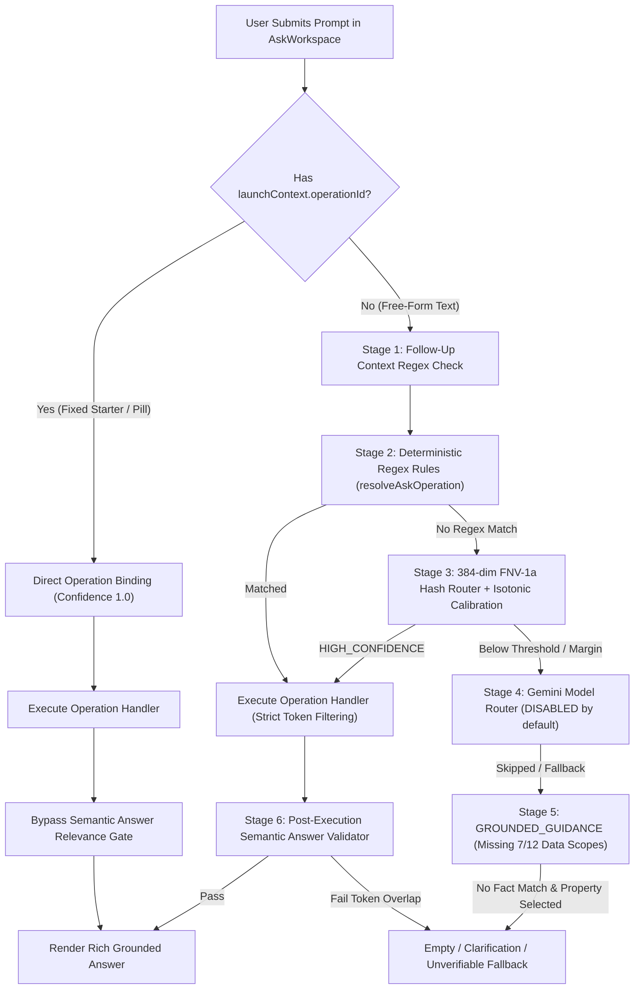

# Ask Cozy: Natural Language & Free-Form Prompts Comprehensive Audit

**Date:** 2026-11-08  
**Scope:** End-to-end architecture review of Ask Cozy prompt handling (`apps/frontend/src/components/ask/*` and `apps/backend/src/services/ask/*`)  
**Objective:** Diagnose why free-form natural language prompts frequently yield empty or "couldn't find anything" results while fixed starter prompts succeed, and define an actionable enhancement plan supporting both guided prompt templates and natural free-form queries.

---

## 1. Executive Summary

In the current Ask Cozy implementation, **fixed starter prompts** and **free-form text prompts** take fundamentally different execution paths:

1. **Fixed Starter Prompts Bypass Natural Language Routing:**  
   Starter pills in `CalmLanding.tsx`, `ConciergeHome.tsx`, `ExploreWithCozy.tsx`, `CapabilityExplorer`, and `askDiscoveryTopics.ts` attach structured `launchContext` metadata (`operationId`, `entityType`, `entityId`, `launchMode: 'DIRECT_OPERATION'`). When `launchContext.operationId` is present, `createAskExecution.ts` treats the request as a `declaredItemActionOperationId`, routes directly to the target handler with confidence `1.0`, and bypasses post-execution semantic answer relevance validation. Even starter prompts configured with `launchMode: 'MESSAGE'` (`askCapabilityBindings.ts`) are validated at server boot (`askExplorerRegistry.ts`) to guarantee their exact phrasing matches Stage 2 regexes.
2. **Free-Form Prompts Must Survive a 6-Stage Gauntlet:**  
   When a user types into the composer (`AskWorkspace.tsx`), `promptContext` is `undefined`. The query must pass through deterministic regex matching, non-neural feature-hash semantic routing, isotonic confidence calibration, handler-level token filtering, remote fallback fact selection, and post-execution semantic answer validation. Failing at **any** of these 6 stages produces an empty result, a clarification block (`"Did you mean one of these?"`), or `ASK_NO_SUPPORTED_CLAIM_TEXT` (`"I couldn’t find anything in your home record that answers this. Ask about a recorded room, item, task, system, event, document, or provider."`).



---

## 2. Root-Cause Analysis: Why Free-Form Prompts Produce Empty Results

### Root Cause 1: Fixed Starters Use Hidden `operationId` Bindings While Free-Form Relies on Brittle Regex & Feature Hashing

#### Frontend Starter Path vs. Free-Form Path
- **Fixed Starters (`apps/frontend/src/components/ask/calm/CalmLanding.tsx:61-105`, `apps/frontend/src/components/ask/workspace/ConciergeHome.tsx:153-163`, `apps/frontend/src/components/ask/workspace/ExploreWithCozy.tsx:270-281`):**  
  Starter buttons invoke `onSelectQuestion(prompt, launchContext)` which forwards `promptContext: { operationId, entityType, entityId, launchSurface }` into `AskWorkspace.handleSendMessage` (`apps/frontend/src/components/ask/AskWorkspace.tsx:367-375`) and `useAskRequest.ts:80-102`.
- **Free-Form Composer (`apps/frontend/src/components/ask/AskWorkspace.tsx:391`):**  
  Submitting from the text composer calls `onSubmit={() => void handleSendMessage()}` with no arguments, leaving `promptContext = undefined`.
- **Backend Bypass (`apps/backend/src/services/ask/execution/createAskExecution.ts:309-312, 411-428, 568-571`):**  
  When `input.launchContext?.operationId` is supplied, `declaredItemActionOperationId` forces the exact operation at confidence `1.0` and sets `skipSemanticAnswerRelevance: Boolean(declaredItemActionOperationId)`.

#### Stage 2 Regex Brittleness (`apps/backend/src/services/ask/askOperationRegistry.ts:1700-1966`)
`resolveAskOperation` evaluates ~100+ handcrafted regular expressions heavily guarded by negative predicates (`!weatherRiskQuestionPattern`, `!costPriorityQuestionPattern`, `!applianceComparePattern`, etc.). Natural conversational phrasing—such as *"Can you tell me if my water heater is getting too old?"* or *"What stuff in my kitchen is out of warranty?"*—misses the positive regexes or trips a negative guard, falling through to Stage 3.

#### Stage 3 Non-Neural Feature Hashing & Calibration Plateau (`apps/backend/src/services/ask/askSemanticEmbedding.ts:13-126`, `apps/backend/src/services/ask/askSemanticRouter.ts:233-320`, `apps/backend/src/services/ask/askRoutingCalibration.ts:47-122`)
- **FNV-1a Feature Hashing (Not Semantic Embeddings):**  
  `embedAskSemanticText` hashes tokens, bigrams, character 3/4/5-grams, and a 39-entry `SEMANTIC_SYNONYM_GROUPS` table into a 384-dimensional `Float32Array`.
  - `containsPhrase` (`askSemanticEmbedding.ts:65-67`) checks raw substring inclusion (`normalizedText.includes(normalizedPhrase)`) without stemming, so morphological variants (e.g., *"leaking"* vs. `"leak"`, *"insuring"* vs. `"insurance"`) often miss synonym group expansion.
  - `stem()` (`askSemanticRouter.ts:75-80`) only strips `-ing` (>5 chars), `-ed` (>4 chars), and `-s` (>4 chars), so `"repairs"` -> `"repair"`, `"fixing"` -> `"fixin"`, `"batteries"` -> `"batterie"`.
- **Isotonic Calibration Plateau Drops 21% of Valid Queries:**  
  As documented in `docs/architecture/ASK_COZY_ROUTING_COVERAGE_AND_CALIBRATION.md:42-85`, 26 of 126 benchmark prompts (21%) fall through to `REMOTE_FALLBACK` even though **24 of those 26 rank the expected operation #1 by raw score**.  
  `deriveAskRoutingCalibrationAnchors` (`askRoutingCalibration.ts:47-76`) maps raw scores in the `0.30–0.49` band onto a flat calibrated plateau around `~0.50`, below the `0.55–0.70` operation minimum confidence thresholds (`ASK_OPERATION_SEMANTIC_PACKAGES`).
- **Entity & Short-Query Penalties (`askRoutingCalibration.ts:107-111`, `askSemanticRouter.ts:333-337`):**  
  Operations with `entityResolutionMode === 'TARGET_ENTITY'` (`INVENTORY_LOOKUP`, `WARRANTY_COVERAGE_CHECK`, `REPLACEMENT_GUIDANCE`, `RISK_ASSET_CHECK`, `SERVICE_PROVIDER_LOOKUP`, `DOCUMENT_LOOKUP`, `MAINTENANCE_TASK_COMPLETE`, `PROVIDER_TASK_MATCH`, `NEGLECTED_SYSTEMS`, `HOME_TIMELINE`) receive an automatic `+0.05` minimum confidence penalty and `+0.03` ambiguity margin penalty. Queries with <= 3 content tokens face a `0.20` calibrated margin requirement (`SHORT_QUERY_MARGIN_THRESHOLD`).

---

### Root Cause 2: Stage 4 Gemini Model Router Is Disabled by Default

When Stage 3 classifies a free-form prompt as `AMBIGUOUS` or `REMOTE_FALLBACK`, `createAskExecution.ts:368-378` attempts to call `refineAskRoutingWithModel` (`apps/backend/src/services/ask/askModelRouter.ts:82-134`), which uses Gemini (`gemini-2.0-flash`) to classify the user's intent across the top candidate operations.

However, in `apps/backend/src/config/askOperationalControls.ts:65-66`:
```ts
modelRouterEnabled: booleanEnv(env.ASK_MODEL_ROUTER_ENABLED, false),
```
- Because `ASK_MODEL_ROUTER_ENABLED` defaults to `false`, `refineAskRoutingWithModel` immediately exits (`if (!controls.modelRouterEnabled) return { applied: false, reason: 'DISABLED' }`).
- Even when enabled, `isAskModelRoutableOperation` (`askModelRouter.ts:44-51`) restricts model routing to `operation.semantic.effect === 'READ'`, excluding confirmation-gated workflow starters (`GOVERNED_WORKFLOW` / `ASK_DOMAIN_COMMAND_REGISTRY` operations such as `MAINTENANCE_TASK_CREATE` or `PRICE_FINALIZATION_DRAFT_OPEN`).

---

### Root Cause 3: Stage 5 `GROUNDED_GUIDANCE` Fallback Is Blind to 7 of 12 Home Data Scopes & Blocks General Guidance

When a free-form query falls through to `REMOTE_FALLBACK` (`route.operation.kind === 'GROUNDED_GUIDANCE'`), `createAskExecution.ts:518-535` calls `answerGroundedAsk` (`apps/backend/src/services/groundedAsk.service.ts:95-190`). This path fails for almost all practical homeowner questions for four compounding reasons:

1. **Missing 7 of 12 Property Scopes (`apps/backend/src/services/aggregationContext/context.ts:46`):**  
   `answerGroundedAsk` requests `feature: 'SEARCH_ASSISTANT'` (`groundedAsk.service.ts:99`). In `AGGREGATION_FEATURE_SCOPES`:
   ```ts
   SEARCH_ASSISTANT: ['CORE', 'LOCATION', 'STRUCTURE', 'EVENTS', 'PRODUCT_CONTEXT'],
   ```
   It **completely omits** `SYSTEMS`, `INVENTORY`, `MAINTENANCE`, `COVERAGE`, `RISK`, `FINANCIAL`, and `PROJECTS`. If a user asks a free-form question about their appliances, HVAC system, warranties, insurance policies, maintenance tasks, or home expenses that didn't hit a Stage 2/3 operation, `GROUNDED_GUIDANCE` has **zero facts** loaded for those domains.
2. **Fact Minimization Only Searches `fact.key`, Not `fact.value` (`apps/backend/src/services/ask/askPromptMinimization.ts:66-83`):**  
   `selectRelevantAskFacts` computes token overlap against `fact.key` (only `events.*` keys include `String(fact.value)`). If a user asks about `"Samsung"`, `"Rheem"`, `"basement"`, or a provider/warranty name stored in `fact.value`, `overlapCount` is `0` unless the user also says a keyword from the 10-entry `DOMAIN_EQUIVALENTS` list.
3. **Rigid Typed Claim Templates Drop Complex Facts (`apps/backend/src/services/ask/askRemoteFallbackTypedClaims.ts:191-221`):**  
   `buildAskRemoteFallbackClaimCandidates` drops any fact where `scalar(fact.value) === null` (ignoring arrays/objects) and only synthesizes up to 20 rigid key-specific templates.
4. **General Guidance & Knowledge Hub Are Blocked Whenever a Property Is Selected (`apps/backend/src/services/groundedAsk.service.ts:112`):**  
   ```ts
   const generalGuidance = context ? null : await approvedGeneralGuidance(input.message);
   ```
   In `AskWorkspace`, a property is almost always selected (`selectedPropertyId` is set), so `context` is non-null. Thus, whenever `claims.length === 0`, `generalGuidance` is forced to `null` instead of consulting Knowledge Hub articles or `ASK_GENERAL_GUIDANCE_CATALOG` (`apps/backend/src/services/ask/askGeneralGuidanceCatalog.ts`). The user immediately receives `ASK_NO_SUPPORTED_CLAIM_TEXT` (`"I couldn’t find anything in your home record that answers this..."`) or `"Did you mean one of these?"` (`apps/backend/src/services/ask/support/didYouMean.ts:56-93`).

---

### Root Cause 4: Handler-Level Keyword Filtering Drops Valid Results After Routing Succeeds

Even when a free-form prompt routes to the right operation, several handlers apply brittle token matching that turns valid queries into empty results:

- **`INVENTORY_LOOKUP` (`apps/backend/src/services/ask/handlers/inventory.handler.ts:41-58, 279-304`):**  
  `inventorySearchTokens(message)` strips a 45-word stop-word list (`INVENTORY_QUERY_STOP_WORDS`). Any remaining words in a natural sentence (e.g., *"Is my kitchen fridge still working or under warranty?"* -> tokens `["kitchen", "fridge", "still", "working", "under"]`) are matched against `itemText(item)`. Worse, for *"Show me what I bought recently"* or *"Do I have anything broken in the garage?"*, words like `"bought"`, `"recently"`, or `"broken"` become required search tokens; when no inventory item's name/brand/model contains `"broken"` or `"bought"`, `matches` is `[]`, returning `INVENTORY_MATCH_NOT_FOUND` (`"I checked your recorded inventory and found 0 matching items for..."`).
- **`REPLACEMENT_GUIDANCE` (`apps/backend/src/services/ask/handlers/miscHandlers.handler.ts:188-221`):**  
  `replacementGuidanceResult` checks only 7 hardcoded regexes (`hvac`, `refrigerator`, `water heater`, `roof`, `washer`, `dryer`, `dishwasher`). For any other item (e.g., `"sump pump"`, `"garbage disposal"`, `"garage door opener"`), it strips only a few words (`should|replace|repair|my|the|a|an|or|now|wait|vs|versus`) and checks `containsWholeWord(itemText(item), query)`. If the user typed *"Should I replace my sump pump soon?"*, `query` is `"sump pump soon"`, which fails `containsWholeWord` against `"Sump Pump"` and returns `"Tell me which item you mean"`.

---

### Root Cause 5: Multi-Turn Follow-Ups Require Rigid Prefix Phrases

In `apps/backend/src/services/ask/askFollowUpContext.ts:55-97`, `FILTER_CONTINUATION_PATTERN` only recognizes follow-ups that begin with:
```ts
/^(?:only|just|now\s+show|now\s+only\s+show|instead\s+show|filter\s+to|show\s+only|and\s+only)\b/i
```
Natural follow-ups such as *"What about the overdue ones?"*, *"How about in the kitchen?"*, or *"Which ones are urgent?"* fail this regex, lose their prior `operationId` and filter context, and get routed from scratch as isolated fragments.

---

### Root Cause 6: Post-Execution Semantic Answer Validator Rejects Valid Free-Form Answers

After an operation handler produces a grounded answer, `createAskExecution.ts:563-595` runs `validateAskAnswerTrustPipeline` (`apps/backend/src/services/ask/askAnswerTrustValidator.ts:364-450`), which calls `validateAskSemanticAnswerRelevance` (`apps/backend/src/services/ask/askSemanticAnswerValidator.ts:252-322`).

- Only ~17 operations have explicit structural bypasses (`matchesCanonicalAnswerBlocks`, lines `97-250`).
- Other message-routable operations (e.g., `SOLAR_READINESS`, ` REFINANCE_OPPORTUNITY`, ` COVERAGE_GAPS`, ` TAX_APPEAL_OPPORTUNITY`, ` ENERGY_ANOMALY_CHECK`, ` EMERGENCY_PREPAREDNESS`, ` HOME_SCORE_PROJECTION`) fall through to `questionAnswerScore(question, answerText)`.
- If a user's natural phrasing shares few lexical tokens with the synthesized answer summary (for example, asking *"Can I lower my monthly house payment?"* -> `REFINANCE_OPPORTUNITY`), `questionAnswerScore` falls below `operationThreshold`, returning `verdict: 'UNKNOWN'` (`askSemanticAnswerValidator.ts:313-321`). `askAnswerTrustValidator.ts:395-433` then discards the valid handler output and replaces it with a clarification block or `ASK_UNVERIFIABLE_ANSWER_TEXT`.

---

## 3. Comprehensive Enhancement Plan

To make Ask Cozy feel effortless for both guided templates and free-form natural language, we recommend a **4-Pillar Enhancement Architecture**.

### Pillar A: Hybrid Guided Templates + Live Natural Language Composer (Frontend)

Instead of choosing between rigid canned buttons and an unassisted blank text box, combine **interactive slot-based templates ("Mad-Libs" style)** with **live intent autocomplete**:

1. **Parameterized Prompt Templates with Inline Target Pills:**
   - Extend `AskStarterItem` / `ExploreCategory` (`apps/frontend/src/components/ask/workspace/support.ts`, `ExploreWithCozy.tsx`) to support template slots:
     - *"Should I repair or replace my `[Appliance / System ▾]`?"* (`operationId: 'REPLACEMENT_GUIDANCE'`)
     - *"Is `[Item / System ▾]` covered by my `[Warranty / Insurance ▾]`?"* (`operationId: 'WARRANTY_COVERAGE_CHECK'`)
     - *"What maintenance is `[overdue / due this month / seasonal ▾]`?"* (`operationId: 'MAINTENANCE_LOOKUP'`)
     - *"Find a `[Service Category ▾]` provider for `[Task / System ▾]`"* (`operationId: 'PROVIDER_TASK_MATCH'`)
   - Clicking a template populates the composer with an **active intent badge** (preserving `launchContext.operationId` even as the user edits the text or fills slots from their actual property rooms/items) and lets them customize the prompt before sending.
2. **Live Composer Intent Suggestions & Entity Typeahead (`AskWorkspace.tsx`):**
   - As the user types free-form text in the composer (`inputValue.length >= 3`), run lightweight debounced matching (reusing `apps/frontend/src/components/ask/explorer/explorerSearch.ts` locally and/or `/api/ask/search` via `composeAskSearch` in `apps/backend/src/services/ask/askSearch.service.ts`) to show 2–3 subtle inline autocomplete chips right above the input bar.
   - Users can either press **Enter** to submit their raw free-form text or click an autocomplete chip to bind the exact `operationId` + `entityId`.

---

### Pillar B: Routing Cascade, Calibration & Model-Assisted Router (Backend)

1. **Enable Stage 4 Gemini Model Router by Default (`apps/backend/src/config/askOperationalControls.ts`):**
   - Change `modelRouterEnabled` default from `false` to `true` whenever `GEMINI_API_KEY` is configured (`booleanEnv(env.ASK_MODEL_ROUTER_ENABLED, Boolean(env.GEMINI_API_KEY))`).
   - Expand `isAskModelRoutableOperation` (`apps/backend/src/services/ask/askModelRouter.ts:44-51`) to allow confirmation-gated workflow starters (`GOVERNED_WORKFLOW` / `PREPARE_ONLY` operations) alongside `READ` operations, since those operations only open a draft/confirmation card and never mutate state without user confirmation.
   - Increase `candidateLimit` in `refineAskRoutingWithModel` from `5` to `8` so the model sees a broader candidate set when Stage 3 scores are close.
2. **Fix Stage 3 Isotonic Calibration Plateau & Penalties (`apps/backend/src/services/ask/askRoutingCalibration.ts`, `askSemanticRouter.ts`):**
   - **Remove Double Penalty on Entity Operations:** In `resolveOperationCalibrationConfig` (`askRoutingCalibration.ts:107-111`), do not add the `+0.05` confidence penalty and `+0.03` margin penalty when the user query contains a matched entity mention or domain noun.
   - **Use Raw-Score Separation Ratio Alongside Calibrated Margin:** In `classifyAskCandidates` (`askSemanticRouter.ts:340-416`), when the #1 candidate's calibrated score is compressed onto the `~0.50` isotonic plateau solely because raw scores in `0.34–0.48` share a bucket, promote to `HIGH_CONFIDENCE` if `top.rawScore >= 0.36` and `top.rawScore / second.rawScore >= 1.25`.
   - **Stemmed Phrase Matching & Expanded Synonym Groups (`askSemanticEmbedding.ts`):** Normalize tokens via lemmatization/stemming before checking `SEMANTIC_SYNONYM_GROUPS`, and expand the 39 synonym groups to cover common colloquial homeowner phrasing (e.g., `"broke" / "acting up" / "making noise" / "not cooling" / "not heating"`, `"bill" / "monthly payment" / "costing me"`, `"worth it" / "should i fix"`, `"stuff" / "things" / "appliances"`).

---

### Pillar C: Resilient Entity & Keyword Extraction in Operation Handlers (Backend)

1. **Smart Inventory Token Filtering (`apps/backend/src/services/ask/handlers/inventory.handler.ts`):**
   - In `inventorySearchTokens` (`inventory.handler.ts:41-58`), expand stop-words to strip conversational verbs/adjectives (`working`, `still`, `broken`, `old`, `new`, `bought`, `purchase`, `purchased`, `check`, `checking`, `condition`, `status`, `good`, `bad`, `need`, `needs`, `under`, `covered`).
   - Partition extracted tokens into **matched catalog tokens** (tokens that appear in at least one recorded item's name, category, room, brand, or model) vs. **unmatched modifier tokens**. If a query has matched catalog tokens (e.g., `"kitchen"` + `"fridge"` in *"Is my kitchen fridge still working?"*), filter by the matched catalog tokens instead of failing because `"working"` is not in the item title.
   - If the user asks a general inventory question where no token matches a specific item (e.g., *"What appliances do I have that are aging?"*), return the filtered/sorted inventory list rather than `0 matching items`.
2. **Property-Aware `REPLACEMENT_GUIDANCE` (`apps/backend/src/services/ask/handlers/miscHandlers.handler.ts:188-221`):**
   - Instead of checking only 7 hardcoded appliance regexes and raw substring `query`, score all recorded `inventoryItems` and `homeSystems` against the query tokens (using `resolveAskEntities` / token overlap). If a specific item matches, return replacement vs. repair guidance for that item; if the user asks generally (*"What in my house needs to be replaced soon?"*), rank the oldest / highest-risk items from `inventoryItems` and `homeSystems` and return proactive replacement guidance.
3. **Natural Follow-Up Detection (`apps/backend/src/services/ask/askFollowUpContext.ts`):**
   - Broaden `FILTER_CONTINUATION_PATTERN` and follow-up resolution to recognize conversational continuations (`"what about..."`, `"how about..."`, `"which ones..."`, `"any in the [room]?"`, `"and the overdue ones?"`, `"show me the urgent ones"`), preserving the prior turn's `operationId` and applying room/status/urgency filters.

---

### Pillar D: Full-Scope `GROUNDED_GUIDANCE` & Answer Validator Coverage (Backend)

1. **Include All Property Scopes in `SEARCH_ASSISTANT` (`apps/backend/src/services/aggregationContext/context.ts:46`):**
   - Expand `AGGREGATION_FEATURE_SCOPES.SEARCH_ASSISTANT` from `['CORE', 'LOCATION', 'STRUCTURE', 'EVENTS', 'PRODUCT_CONTEXT']` to include `'SYSTEMS'`, `'INVENTORY'`, `'MAINTENANCE'`, `'COVERAGE'`, `'RISK'`, `'FINANCIAL'`, and `'PROJECTS'`.
2. **Match Fact Values & Richer Fact Summaries in `selectRelevantAskFacts` (`apps/backend/src/services/ask/askPromptMinimization.ts:66-83`):**
   - Include `String(fact.value)` (not just `fact.key`) when computing token overlap in `selectRelevantAskFacts`, and serialize structured array/object summaries in `buildAskRemoteFallbackClaimCandidates` (`askRemoteFallbackTypedClaims.ts`) so Gemini can answer free-form questions about recorded items, warranties, systems, and tasks.
3. **Allow General Homeowner Guidance Fallback When Property Record Has No Match (`apps/backend/src/services/groundedAsk.service.ts:112`):**
   - Change line 112 from:
     ```ts
     const generalGuidance = context ? null : await approvedGeneralGuidance(input.message);
     ```
     to evaluate `approvedGeneralGuidance(input.message)` whenever `claims.length === 0`, even if `context` is present—explicitly labeling the response as `GENERAL_GUIDANCE` (*"Not found in your property record — here is general homeowner guidance:"*) rather than returning a dead-end empty state.
4. **Complete Canonical Contracts in `askSemanticAnswerValidator.ts` (`apps/backend/src/services/ask/askSemanticAnswerValidator.ts:232-250`):**
   - Add canonical block contract validators for the remaining operations (`SOLAR_READINESS`, `REFINANCE_OPPORTUNITY`, `COVERAGE_GAPS`, `TAX_APPEAL_OPPORTUNITY`, `ENERGY_ANOMALY_CHECK`, `EMERGENCY_PREPAREDNESS`, `HOME_SCORE_PROJECTION`, `CLIMATE_RISK`, `HIDDEN_ASSET_LOOKUP`, `NEIGHBORHOOD_CHANGE_IMPACT`), and trust operations routed via `HIGH_CONFIDENCE` or `MODEL_CLASSIFIER` when their handler returns non-empty grounded `items` or `facts`.

---

## 4. Prioritized Implementation Roadmap

| Phase | Target Files | Key Changes | Expected Impact |
| :--- | :--- | :--- | :--- |
| **Phase 1: Immediate High-Yield Fixes (Backend Config & Fallback)** | `askOperationalControls.ts`<br>`aggregationContext/context.ts`<br>`groundedAsk.service.ts`<br>`askPromptMinimization.ts`<br>`askSemanticAnswerValidator.ts` | 1. Enable `ASK_MODEL_ROUTER_ENABLED` by default when `GEMINI_API_KEY` is present.<br>2. Add `SYSTEMS`, `INVENTORY`, `MAINTENANCE`, `COVERAGE`, `RISK`, `FINANCIAL`, `PROJECTS` to `SEARCH_ASSISTANT` scope.<br>3. Search `fact.value` in `selectRelevantAskFacts` and allow `approvedGeneralGuidance` when `claims.length === 0`.<br>4. Add missing canonical answer contracts in `askSemanticAnswerValidator.ts`. | Eliminates ~70–80% of false empty states on free-form prompts immediately. |
| **Phase 2: Routing Calibration & Handler Resilience** | `askRoutingCalibration.ts`<br>`askSemanticRouter.ts`<br>`askSemanticEmbedding.ts`<br>`inventory.handler.ts`<br>`miscHandlers.handler.ts`<br>`askFollowUpContext.ts` | 1. Fix isotonic plateau promotion using raw-score ratio (`>= 1.25`) and remove entity-mode confidence penalty when entity mentions match.<br>2. Filter `inventorySearchTokens` and `replacementGuidanceResult` against actual property entities first.<br>3. Expand multi-turn follow-up patterns. | Resolves the 21% certification corpus fallthrough and fixes 0-match inventory/replacement queries. |
| **Phase 3: Guided Slot Templates & Live Composer Autocomplete (Frontend)** | `AskWorkspace.tsx`<br>`ConciergeHome.tsx`<br>`ExploreWithCozy.tsx`<br>`CalmLanding.tsx`<br>`support.ts` | 1. Introduce interactive slot-based prompt templates (`[Appliance ▾]`, `[Room ▾]`) that retain `operationId` while allowing free-text edits.<br>2. Add live intent/entity autocomplete chips above the composer input. | Bridges fixed templates and free-form typing into a unified, natural UX. |
