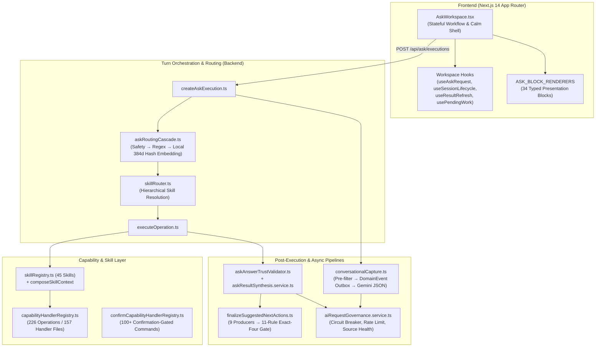

# Comprehensive Technical Architecture Review: "Ask Cozy"

**Review Date:** November 5, 2026  
**Scope:** End-to-end architecture review of Ask Cozy across backend orchestration, routing, skills, capability invocation, confirmation sagas, conversational capture, suggested next actions, AI governance, and frontend generative UI workspace.

As implemented in the current repository, **Ask Cozy** is not a thin LLM wrapper or freeform chatbot. It is a **deterministic-first, governance-bounded conversational operating system** over Contract to Cozy’s canonical property records and domain engines.

---

## 1. Architectural Overview & End-to-End Topology

Ask Cozy is structured around a three-layer operating model (**Conversation → Capability → Knowledge**) where canonical domain services own business state and the LLM is strictly constrained to structured extraction, bounded candidate claim selection, and optional summary rephrasing.

### Core Architectural Pillars

1. **Decomposed Facade & Lifecycle Engine:** The former ~20,000-line monolith in `apps/backend/src/services/ask/askOrchestrator.service.ts` has been decomposed into a thin re-export facade backed by lifecycle modules under `apps/backend/src/services/ask/execution/` (`createAskExecution.ts`, `executeOperation.ts`, `askConfirm.ts`, `askCapture.ts`, `askClarification.ts`) and **157 capability handler files** in `apps/backend/src/services/ask/handlers/*.handler.ts`.
2. **Multi-Stage Deterministic-First Routing:** `resolveAskRoutingCascade` (`apps/backend/src/services/ask/askRoutingCascade.ts`) evaluates requests in strict order: `SAFETY` (intercepted before property scope) → `DETERMINISTIC` regex/intent rules → `LOCAL_CLASSIFIER` (a deterministic 384-dimension feature-hashed embedding and concept-synonym router in `apps/backend/src/services/ask/askSemanticEmbedding.ts`) → `resolveHierarchicalSkillRouting` (`apps/backend/src/services/skills/skillRouter.ts`) → `CLARIFICATION` → `REMOTE_FALLBACK` (`GROUNDED_GUIDANCE`).
3. **Two-Phase Propose-and-Confirm Mutation Saga:** Consequential writes never execute on free-text inference. Propose-time handlers return an `AskExecution` in `NEEDS_CONFIRMATION` status. Confirmation (`confirmAskExecution` in `apps/backend/src/services/ask/execution/askConfirm.ts`) verifies `skillBindingJson` staleness, household role floor, audience applicability, `confirmationVersion`, and claims a lease-backed `AskConfirmationReceipt` before dispatching to `confirmCapabilityInvoke` (`apps/backend/src/services/ask/confirmCapabilityHandlerRegistry.ts`) and running sibling result reconciliation (`ASK_MUTATION_IMPACT_REGISTRY`).
4. **Parallel Outbox-Backed Conversational Capture:** Independent of which operation routed, `runConversationalCaptureForTurn` (`apps/backend/src/services/ask/conversationalUnderstanding/conversationalCapture.ts`) runs a cheap pre-filter (`extractionPreFilter.ts`), persists a durable `ASK_EXTRACTION_REQUESTED` `DomainEvent` first, and attempts a 1.5s bounded inline structured Gemini extraction (`extractionContract.ts`) with shared lease-token verification (falling back to the background worker on timeout) to spawn child `NEEDS_CONFIRMATION` cards for facts, events, warranties, evidence, and goals.
5. **Compile-Time Enforced Generative UI Contract:** Responses use a 34-variant discriminated union (`AskPresentationBlock` in `apps/backend/src/productFramework/ask/ask.contract.ts`) mapped 1:1 to React renderers in `ASK_BLOCK_RENDERERS` (`apps/frontend/src/components/ask/blocks/registry.tsx`).

---

## 2. Comprehensive Pros & Cons Analysis

### Architectural Pros (Strengths)

* **Zero-Hallucination Financial & Record Integrity:**
  * `apps/backend/src/services/groundedAsk.service.ts` and `apps/backend/src/services/ask/askRemoteFallbackTypedClaims.ts` forbid Gemini from originating facts; the LLM only selects from pre-rendered deterministic claims backed by `PropertyFact` provenance.
  * `synthesizeAskResult` (`apps/backend/src/services/ask/askResultSynthesis.service.ts`) parses numerical tokens out of LLM summaries and throws an error (`Ask synthesis introduced an unsupported numerical claim`) if any number does not appear verbatim in the validated input payload.
* **Defense-in-Depth Authorization & Concurrency Control:**
  * Every read/propose invocation passes through `invokeGuarded` (`apps/backend/src/services/ask/capabilityHandlerRegistry.ts`), which enforces operational kill-switches, skill health, property scope, and `HouseholdRole` floors (`VIEWER < CONTRIBUTOR < OWNER`) even if called outside the orchestrator.
  * `confirmAskExecution` (`apps/backend/src/services/ask/execution/askConfirm.ts`) performs an atomic compare-and-swap on `status: 'NEEDS_CONFIRMATION'` and `parametersJson.confirmationVersion` inside a Prisma transaction, preventing TOCTOU races when a user edits a proposal in one tab while confirming in another.
  * Client-selected follow-up chips are verified against the server-stored offered-action ledger (`resolveSuggestedActionSelection` in `apps/backend/src/services/ask/execution/createAskExecution.ts`), preventing client-forged `operationId` or `entityId` injection.
* **Fail-Fast Boot-Time Registry Validation:**
  * Startup validators (`validateCapabilityHandlerRegistry`, `validateConfirmCapabilityHandlerRegistry`, `validateSkillDefinitions`, and `validateSkillAdapterDefinitions`) verify that all 226 operations, adapters, and domain commands wire up cleanly before serving traffic.
* **Resilient Outbox & Lease-Token Coordination for Async AI Work:**
  * `conversationalCapture.ts` solves the classic sync-vs-async race by persisting `DomainEvent` intent before calling the LLM, using shared lease ownership with the background worker (`processDomainEvents.job.ts`), and verifying the claim generation token on commit so a slow inline call cannot overwrite a reclaimed worker run.
* **Rich Stateful UI Reconciliation & Access-Loss Redaction:**
  * `AskWorkspace.tsx` (`apps/frontend/src/components/ask/AskWorkspace.tsx`) immediately purges and redacts in-memory executions, session storage views, and pending work if property access is revoked mid-session (`redactHistoryAccessLoss`).

---

### Architectural Cons & Risks (Findings)

1. **[P1] Split Ownership Between Skill-Governed Operations and Platform/Command Operations**
   * **Location:** `apps/backend/src/services/skills/skillRegistry.ts:79-140`, `apps/backend/src/services/skills/adapters/skillAdapterRegistry.ts:29-154`, and `apps/backend/src/services/ask/execution/executeOperation.ts:240-305`
   * **Explanation:** While `ASK_OPERATION_DEFINITIONS` has grown to **226 operations** across **157 handler files**, `SKILL_DEFINITIONS` in `skillRegistry.ts` still groups only 45 skills and `SKILL_ADAPTER_DEFINITIONS` in `skillAdapterRegistry.ts` defines ~125 adapters. When `getSkillForOperation(operationId)` returns `undefined` in `executeOperationCore`, the execution bypasses `composeSkillContext`, `evaluateAskAudienceApplicability`, `applyAskAudiencePresentation`, and `SkillAdapterDefinition` governance, dispatching directly via `dispatchOperationAdapter`. This creates two tiers of operations: fully skill-governed operations and unowned/platform operations that rely solely on operation-level role floors.
2. **[P1] Import Side-Effect Registration Pattern & Duplicate Import Fragility**
   * **Location:** `apps/backend/src/services/ask/askOrchestrator.service.ts:9-174` (specifically duplicate `import './handlers/claimActivity.handler';` at lines 141–142)
   * **Explanation:** Handler registration relies on top-level side effects when `askOrchestrator.service.ts` is imported (`registerCapabilityHandler` / `registerConfirmCapabilityHandler`). Any test, script, or worker module that imports `capabilityInvoke` (`apps/backend/src/services/ask/capabilityHandlerRegistry.ts`) without first importing `askOrchestrator.service.ts` will encounter an empty handler map at runtime.
3. **[P1] Synchronous Single-Turn Serialization & Database Write Amplification**
   * **Location:** `apps/backend/src/services/ask/execution/createAskExecution.ts:112-664`
   * **Explanation:** A single user turn performs **8 to 14 sequential database round-trips** before returning an HTTP response: eligibility check → property access check → idempotency lookup → session lookup/update → suggested-action verification → `AskExecution.create(RECEIVED)` → `AskExecutionEvent.create(RECEIVED)` → follow-up query → `AskExecutionEvent.create(CAPABILITY_RESOLVED)` → `AskExecution.update(RUNNING)` → skill context composition → handler DB queries → `finalizeSuggestedNextActions` history/entity queries → `AskExecution.update(ANSWERED)` → 3 telemetry event inserts → inline conversational capture (`DomainEvent` + LLM call up to 1.5s). There is no HTTP streaming (SSE/WebSocket), so the user waits for the entire chain to settle.
4. **[P2] Local "Semantic Embedding" is a Lexical/Bag-of-N-Grams Hash, Not a True Vector Model**
   * **Location:** `apps/backend/src/services/ask/askSemanticEmbedding.ts:13-116`
   * **Explanation:** `embedAskSemanticText` hashes words, bigrams, character 3/4/5-grams, and a hardcoded 40-entry `SEMANTIC_SYNONYM_GROUPS` table into a 384-float array using FNV-1a (`hashFeature`). While fast, deterministic, and zero-cost, it has zero semantic comprehension outside the hardcoded synonym list and operation example phrases. Novel user phrasings that do not share character n-grams or curated synonyms with registered examples fall through to `GROUNDED_GUIDANCE` or `CLARIFICATION`.
5. **[P2] In-Memory AI Rate Limiting and Circuit Breaking Across Multi-Instance / Worker Boundaries**
   * **Location:** `apps/backend/src/services/ai/aiRequestGovernance.service.ts:27-38`
   * **Explanation:** `circuits`, `rateWindows`, and `routeHealth` are stored in process-local `Map` instances. Because C2C runs separate `backend` and `workers` processes (and potentially multiple replicas in k3s), rate limits and circuit breaker states are not shared across processes via Redis. Furthermore, `publishRouteHealthIfChanged` (`aiRequestGovernance.service.ts:44-64`) calls `allPropertyIds()` and emits source-health changes across *all* properties in the database whenever an AI route transitions health state—which will become an $O(N_{\text{properties}})$ bottleneck as property count scales.
6. **[P2] Fragmented Provenance & Confidence Models Across the Knowledge Layer**
   * **Location:** `apps/backend/src/services/ask/conversationalUnderstanding/conversationalCapture.ts:138-153` and `apps/backend/prisma/schema.prisma`
   * **Explanation:** Home knowledge remains split across `PropertyFactEvidence`, `HomeEvent`, `SignalProvenance`, `ExtractedFactCandidate`, and legacy `Document` vs. Home Record tables (noted explicitly in `conversationalCapture.ts:138`: *"Stays on the legacy Document table on purpose... This reader converts together with the home-event evidence link"*).

---

## 3. Modularity for Future Enhancements

**Verdict: Highly modular within existing patterns, but high-ceremony (boilerplate-heavy) per new capability.**

### What Makes It Modular
* **Plug-and-Play Handler & Block Registries:** Adding a new read or write capability does not require touching the core routing algorithm or orchestrator control flow. A developer registers an operation in `askOperationRegistry.ts`, adds a handler in `services/ask/handlers/*.handler.ts` calling `registerCapabilityHandler`, and (if mutating) registers a confirm handler in `confirmCapabilityHandlerRegistry.ts`.
* **CLI-Scaffolded Skill Packages:** `apps/backend/src/scripts/createSkillPackage.ts` (`npm run skill:create`) scaffolds `SKILL.md`, `skill.manifest.ts`, and `skill.evaluation.ts`, automatically integrating with `SKILL_SEMANTIC_INDEX` and `detectSkillSemanticConflicts` (`skillRouter.ts:134-148`).
* **TypeScript-Enforced Exhaustiveness:** If you add a new `AskPresentationBlock` type in `ask.contract.ts` or a new `AskOperationId`, TypeScript compilation fails until `ASK_BLOCK_RENDERERS` and coverage matrices are updated.
* **Composable Next-Action Producers:** `finalizeSuggestedNextActions` cleanly separates candidate nomination (9 independent producers) from the 11-rule eligibility and "Exact-Four" selection gate.

### Where Modularity Breaks Down (Friction Points)
* **High Touch-Point Fan-Out:** Adding a single new domain capability requires coordinated edits across **8 to 10 central files**:
  1. `apps/backend/src/services/ask/askOperationRegistry.ts` (1,885 lines — union type, regex rule, and definition object)
  2. `apps/backend/src/services/ask/askOperationSemanticPackages.ts` (positive/hard-negative phrases)
  3. `apps/backend/src/services/ask/askDomainCommandRegistry.ts` (if write)
  4. `apps/backend/src/services/skills/skillRegistry.ts` & `apps/backend/src/services/skills/adapters/skillAdapterRegistry.ts`
  5. `apps/backend/src/services/ask/askAudiencePolicy.ts` & `apps/backend/src/services/ask/askInteractionCoverageMatrix.ts`
  6. `apps/backend/src/services/ask/suggestedActions/operationSpecificContinuationCoverage.ts` (plus bumping the reviewed SHA-256 operation registry hash)
  7. `apps/backend/src/services/ask/askOrchestrator.service.ts` (side-effect import)
  * *Recommendation:* Consolidate per-operation metadata (definition, semantic package, command spec, adapter spec, continuation recipes) into colocated **Self-Contained Operation Modules** that auto-assemble at build/startup time rather than maintaining 7+ parallel central registries.
* **Frontend Workspace Coupling:** While `AskWorkspace.tsx` was slimmed down to 579 lines by extracting hooks (`useSessionLifecycle`, `useConversationHistory`, `useResultRefresh`), those hooks pass **15–25 state setters and refs** back and forth (`AskWorkspace.tsx:101-147`). Introducing a unified state machine (e.g., `useReducer` or Zustand store scoped to the workspace provider) would make UI enhancements much cleaner.

---

## 4. Robustness for Future Technological Advancements

**Verdict: Architecturally well-insulated on the contract boundary, but requires targeted upgrades in 5 areas to leverage next-generation AI and platform paradigms.**

| Future Advancement | Current Readiness | Architectural Assessment & Upgrade Path |
| :--- | :---: | :--- |
| **1. Model Upgrades & Multi-Provider LLMs** (Gemini 2.5/3+, Claude, Local SLMs) | **High (8.5/10)** | **Strong:** Because LLMs are never trusted as the source of truth and only interact via schema-validated JSON (`extractionContract.ts:15-21`) and `resolveGovernedAIModel` (`aiRequestGovernance.service.ts:9-13`), swapping foundation models cannot break domain invariants or corrupt records.  **Gap:** Direct `@google/genai` SDK calls in `extractionContract.ts` and `gemini.service.ts` should be behind a provider-agnostic `StructuredLLMProvider` interface. |
| **2. True Dense Vector Embeddings & Hybrid RAG** (pgvector, Gecko/text-embedding-004) | **Medium (6/10)** | **Gap:** `resolveAskRoutingCascade` (`askRoutingCascade.ts:47-155`) is synchronous, and `askSemanticEmbedding.ts:107-116` computes synchronous local n-gram hashes.  **Upgrade Path:** Make `resolveAskRoutingCascade` `async` so Stage 3 (`LOCAL_CLASSIFIER`) can query precomputed dense embeddings (or `pgvector` for unstructured document chunks inside `DOCUMENT_LOOKUP` / `GROUNDED_GUIDANCE`) while keeping Stage 1 (`SAFETY`) and Stage 2 (`DETERMINISTIC`) synchronous. |
| **3. Native Agentic Tool-Calling, Multi-Step Planning & MCP (Model Context Protocol)** | **Medium (6.5/10)** | **Strong:** `CapabilityInvocationEnvelope` (`capabilityHandlerRegistry.ts:189-195`), `SkillDefinition`, and the HVAC specialist agent (`agentRuntime.service.ts`) already mirror MCP tool and resource primitives.  **Gap:** Currently, one turn executes **at most one** routed operation (`1 turn = 1 AskOperationId`). Compound multi-step queries (e.g., *"Compare my roof quotes and check if my reserve fund covers the lowest bid"*) cannot chain two read operations in a single turn. Adding a bounded **Read-Only Plan-and-Execute Loop** (composing 2–3 read `capabilityInvoke` calls before synthesis) is the natural next step. |
| **4. Real-Time Streaming, Voice / Live API & Multimodal Native Turn Processing** | **Low–Medium (4.5/10)** | **Gap:** The request/response contract (`POST /api/ask/executions` returning a monolithic `AskExecutionResponse` after all stages finish) and `AskWorkspace.tsx` (`inFlight` request tracker) are strictly request-response. Voice input (`VoiceInputButton.tsx`) is speech-to-text into the composer, and file intake (`AskIntakeDialog.tsx`) is a separate modal flow.  **Upgrade Path:** Add an SSE/streaming endpoint (`POST /api/ask/executions/stream`) that emits stage progress events (`ROUTED`, `BLOCK_READY`, `SYNTHESIS_DELTA`, `CAPTURE_READY`, `ACTIONS_READY`) so deterministic blocks render in <150ms while synthesis and conversational capture stream in progressively. |
| **5. Offline-First / Edge Execution (PWA)** | **Low (4/10)** | **Gap:** Although C2C's frontend supports PWA/IndexedDB caching in other modules, `AskWorkspace.tsx` requires live server connectivity for session history, concierge home, and execution creation.  **Upgrade Path:** Cache the active `AskSession` and pinned `AskExecutionResponse` blocks in IndexedDB (`src/lib/storage/`) and queue offline capture/task drafts for sync upon reconnection. |

---

## 5. Summary of Strategic Recommendations

1. **Introduce Progressive Streaming (SSE) for Turn Execution:** Decouple the fast deterministic read (`ROUTE_AND_EXECUTE`, typically <100ms) from the slower LLM post-processing stages (`SYNTHESIS` and `INLINE_EXTRACTION`, up to 1.5s+) by streaming the base `AskPresentationBlock[]` immediately and pushing synthesis/capture updates as progressive events.
2. **Unify Operation Registration into Self-Contained Modules:** Replace the 7+ parallel central arrays/maps (`askOperationRegistry.ts`, `askOperationSemanticPackages.ts`, `skillAdapterRegistry.ts`, `operationSpecificContinuationCoverage.ts`) with colocated per-skill/per-operation descriptors validated at build time, eliminating the side-effect import list in `askOrchestrator.service.ts`.
3. **Add a Bounded Multi-Capability Read Planner:** Allow the orchestrator to invoke up to $K$ ($K \le 3$) `READ`-only adapters in parallel when `classifyAskCandidates` returns `MULTI_INTENT` (`askRoutingCascade.ts:143-145`), merging their presentation blocks instead of forcing a clarification prompt between two valid read questions.
4. **Move AI Circuit Breakers & Rate Windows to Redis:** Back `aiRequestGovernance.service.ts:27-64` with Redis so backend nodes and BullMQ workers share unified rate-limit windows and circuit health, and replace the $O(N_{\text{properties}})$ broadcast in `publishRouteHealthIfChanged` with a global source-health state read on demand.
