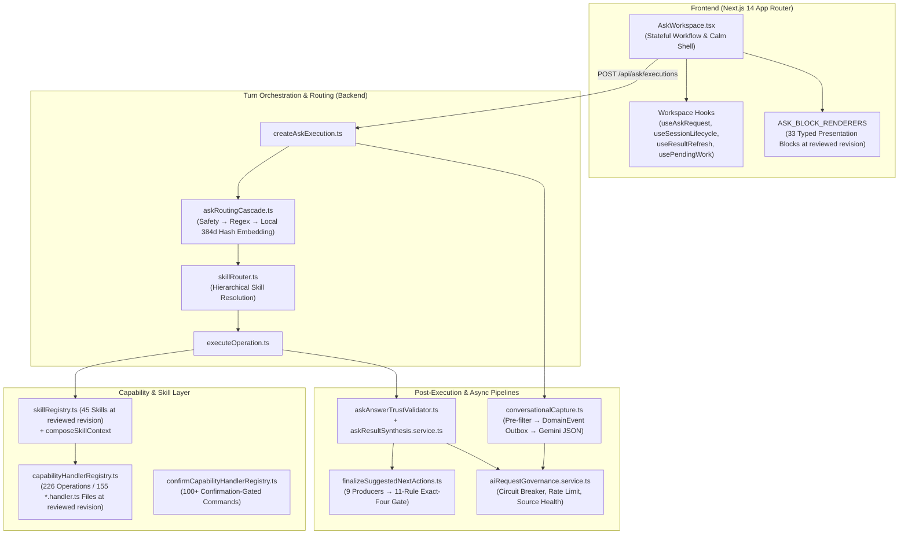

# Comprehensive Technical Architecture Review: "Ask Cozy"

**Review Date:** November 5, 2026

**Base Repository Revision:** `a92f93c90f2da8ec56c565494afc1f9deae77665` (the review document contains uncommitted edits relative to this revision; replace this value with the containing commit SHA after commit)

**Scope:** End-to-end architecture review of Ask Cozy across backend orchestration, routing, skills, capability invocation, confirmation sagas, conversational capture, suggested next actions, AI governance, and frontend generative UI workspace.

As implemented in the current repository, **Ask Cozy** is not a thin LLM wrapper or freeform chatbot. It is a **deterministic-first, governance-bounded conversational operating system** over Contract to Cozy’s canonical property records and domain engines.

### Evidence and interpretation boundary

This is a **static architecture review**, not a production performance report. It was prepared from the base revision above by tracing the active Ask Cozy FRDs, registries, execution paths, contracts, schemas, and representative tests, with Graphify used for cross-file discovery. No database, deployed environment, browser, worker, or production-sized workload was executed for this review. It is not a dedicated threat model, penetration test, test-coverage assessment, production observability audit, or accessibility certification; authorization, telemetry, tests, and accessibility are discussed only where the traced architecture directly depends on them.

Claims in this document use the following meanings:

- **Verified current-state fact:** directly supported by the cited code or contract at the reviewed revision.
- **Code-traced risk:** a structural concern visible in code, but not yet quantified in a runtime environment.
- **Design proposal:** a possible future direction that requires product and architecture approval before implementation.
- Registry and file counts are point-in-time inventory values, not durable architectural invariants. They were counted from parsed TypeScript object/array literals and filesystem suffixes, rather than textual call-site grep: `ASK_OPERATION_DEFINITIONS` object keys (226), `SKILL_DEFINITIONS` object keys (45), `AskPresentationBlockSchema` union elements (33), `ASK_BLOCK_RENDERERS` object keys (33), `SEMANTIC_SYNONYM_GROUPS` elements (39), and `find apps/backend/src/services/ask/handlers -type f -name '*.handler.ts'` (155). Regenerate these measures when the document is refreshed.

Where product requirements and implementation differ, this review reports the discrepancy; it does not silently treat either one as authoritative. The active product constraints most relevant to the recommendations below are LLM independence (`ASK_COZY_SOLE_HOMEOWNER_INTERFACE_FRD.md` §15, FR-PLAT-006), reauthorization and confirmation for consequential actions (same FRD §17), partial-result behavior and measured p50/p95 targets (same FRD §18, FR-PERF-001), accessibility and durable recovery (`ASK_COZY_INTERACTION_MODEL_UI_FRD.md` §14), and the current prohibition on offline or queued mutations (same FRD §14, REC-002).

---

## 1. Architectural Overview & End-to-End Topology

Ask Cozy is structured around a three-layer operating model (**Conversation → Capability → Knowledge**) where canonical domain services own business state. Structured extraction and remote fallback use bounded schemas or candidate selection; optional summary rephrasing is prompt-constrained and numerically checked, but is not a fully claim-validated generation path.

### Core Architectural Pillars

1. **Decomposed Facade & Lifecycle Engine:** The former ~20,000-line monolith in `apps/backend/src/services/ask/askOrchestrator.service.ts` has been decomposed into a thin re-export facade backed by lifecycle modules under `apps/backend/src/services/ask/execution/` (`createAskExecution.ts`, `executeOperation.ts`, `askConfirm.ts`, `askCapture.ts`, `askClarification.ts`) and, at the reviewed revision, **155 `*.handler.ts` files** in `apps/backend/src/services/ask/handlers/`.
2. **Multi-Stage Deterministic-First Routing:** `resolveAskRoutingCascade` (`apps/backend/src/services/ask/askRoutingCascade.ts`) evaluates requests in strict order: `SAFETY` (intercepted before property scope) → `DETERMINISTIC` regex/intent rules → `LOCAL_CLASSIFIER` (a deterministic 384-dimension feature-hashed embedding and concept-synonym router in `apps/backend/src/services/ask/askSemanticEmbedding.ts`) → `resolveHierarchicalSkillRouting` (`apps/backend/src/services/skills/skillRouter.ts`) → `CLARIFICATION` → `REMOTE_FALLBACK` (`GROUNDED_GUIDANCE`).
3. **Two-Phase Propose-and-Confirm Mutation Saga:** Consequential writes never execute on free-text inference. Propose-time handlers return an `AskExecution` in `NEEDS_CONFIRMATION` status. Confirmation (`confirmAskExecution` in `apps/backend/src/services/ask/execution/askConfirm.ts`) verifies `skillBindingJson` staleness, household role floor, audience applicability, `confirmationVersion`, and claims a lease-backed `AskConfirmationReceipt` before dispatching to `confirmCapabilityInvoke` (`apps/backend/src/services/ask/confirmCapabilityHandlerRegistry.ts`) and running sibling result reconciliation (`ASK_MUTATION_IMPACT_REGISTRY`).
4. **Parallel Outbox-Backed Conversational Capture:** Independent of which operation routed, `runConversationalCaptureForTurn` (`apps/backend/src/services/ask/conversationalUnderstanding/conversationalCapture.ts`) runs a cheap pre-filter (`extractionPreFilter.ts`), persists a durable `ASK_EXTRACTION_REQUESTED` `DomainEvent` first, and attempts a 1.5s bounded inline structured Gemini extraction (`extractionContract.ts`) with shared lease-token verification (falling back to the background worker on timeout) to spawn child `NEEDS_CONFIRMATION` cards for facts, events, warranties, evidence, and goals.
5. **Compile-Time Enforced Generative UI Contract:** At the reviewed revision, responses use a 33-variant discriminated union (`AskPresentationBlock` in `apps/backend/src/productFramework/ask/ask.contract.ts`) mapped 1:1 to React renderers in `ASK_BLOCK_RENDERERS` (`apps/frontend/src/components/ask/blocks/registry.tsx`). The exhaustiveness is enforced by `AskBlockRendererRegistry = { [T in AskBlockType]: AskBlockRenderer<T> }`, where `AskBlockType` is derived from `AskPresentationBlock['type']`; omitting a renderer therefore fails TypeScript checking. Runtime unknown-block fallback remains necessary for client/server version skew.

---

## 2. Comprehensive Pros & Cons Analysis

### Architectural Pros (Strengths)

* **Strongly Bounded Financial & Record Integrity:**
  * `apps/backend/src/services/groundedAsk.service.ts` and `apps/backend/src/services/ask/askRemoteFallbackTypedClaims.ts` forbid Gemini from originating facts; the LLM only selects from pre-rendered deterministic claims backed by `PropertyFact` provenance.
  * `synthesizeAskResult` (`apps/backend/src/services/ask/askResultSynthesis.service.ts`) instructs the model to use only a validated result and rejects numerical tokens that do not appear verbatim in the input payload. This is a useful guard, not a proof of zero hallucination: non-numeric factual changes, altered qualifiers, causal claims, or advice are not mechanically checked by that numerical validator. Typed-claim remote fallback and prose result synthesis therefore have different assurance levels.
* **Defense-in-Depth Authorization & Concurrency Control:**
  * Every read/propose invocation made through `capabilityInvoke` enters `invokeGuarded` (`apps/backend/src/services/ask/capabilityHandlerRegistry.ts:189-235`), which enforces operational kill-switches, skill health, property scope, and `HouseholdRole` floors (`VIEWER < CONTRIBUTOR < OWNER`), including direct callers outside the orchestrator that use this public invocation entry point.
  * `confirmAskExecution` (`apps/backend/src/services/ask/execution/askConfirm.ts`) performs an atomic compare-and-swap on `status: 'NEEDS_CONFIRMATION'` and `parametersJson.confirmationVersion` inside a Prisma transaction, preventing TOCTOU races when a user edits a proposal in one tab while confirming in another.
  * Client-selected follow-up chips are verified against the server-stored offered-action ledger (`resolveSuggestedActionSelection` in `apps/backend/src/services/ask/execution/createAskExecution.ts`), preventing client-forged `operationId` or `entityId` injection.
* **Fail-Fast Boot-Time Registry Validation:**
  * Startup validators (`validateCapabilityHandlerRegistry`, `validateConfirmCapabilityHandlerRegistry`, `validateSkillDefinitions`, and `validateSkillAdapterDefinitions`) verify that all 226 operations, adapters, and domain commands wire up cleanly before serving traffic.
* **Resilient Outbox & Lease-Token Coordination for Async AI Work:**
  * `conversationalCapture.ts` addresses the sync-vs-async race by persisting `DomainEvent` intent before calling the LLM and sharing lease ownership with the background worker (`processDomainEvents.job.ts`). Before candidate persistence commits, `verifyClaimStillOwned` performs an `updateMany` conditioned on the claimed `attempts` value inside the transaction and throws unless exactly one row matches. A slow inline attempt therefore cannot commit candidate persistence after a later worker attempt has reclaimed the claim.
* **Rich Stateful UI Reconciliation & Access-Loss Redaction:**
  * `AskWorkspace.tsx` (`apps/frontend/src/components/ask/AskWorkspace.tsx`) immediately purges and redacts in-memory executions, session storage views, and pending work if property access is revoked mid-session (`redactHistoryAccessLoss`).

---

### Architectural Cons & Risks (Findings)

1. **[P1] Skill-Ownership Exceptions Need Classification, Not Just a Count Comparison**
   * **Location:** `apps/backend/src/services/skills/skillRegistry.ts:79-140`, `apps/backend/src/services/intelligence/skillOperationGovernance.contract.ts:45-211`, `apps/backend/src/services/ask/execution/executeOperation.ts:305`, and `apps/backend/src/services/ask/capabilityHandlerRegistry.ts:197-235`
   * **Explanation:** When `getSkillForOperation(operationId)` returns `undefined`, `executeOperationCore` returns directly through `dispatchOperationAdapter` at line 305. That path reaches `capabilityInvoke`/`invokeGuarded`, so operation kill-switches, property scope, and role floors still apply, but skill context composition, skill audience applicability/presentation, and `SkillAdapterDefinition` governance do not. The repository explicitly inventories skill-less operations in `KNOWN_UNGOVERNED_OPERATIONS` and boot-validates undocumented property-scoped gaps. Some exceptions are intentionally internal, launch-only, or platform operations. The actionable risk is therefore not simply “operations outnumber skills.” The inventory must classify every carve-out as (a) an intentional platform/internal exception with equivalent controls, (b) a temporary documented governance gap with an owner and removal condition, or (c) an accidentally unowned routable operation. Category (c), and category (b) without a bounded remediation plan, are P1 issues; intentional exceptions are not automatically defects.
2. **[P2] Latent Coupling From Import Side-Effect Registration**
   * **Location:** `apps/backend/src/services/ask/askOrchestrator.service.ts:9-174` (specifically duplicate `import './handlers/claimActivity.handler';` at lines 141–142)
   * **Explanation:** Handler registration relies on top-level side effects when the orchestrator facade imports the handler modules (`registerCapabilityHandler` / `registerConfirmCapabilityHandler`). The registries do not import handlers themselves, so a future direct caller that invokes a registered operation without loading the facade or the required handler module would receive `AskCapabilityHandlerMissingError`. The reviewed backend fixture-generation script imports the facade explicitly, and this review did not identify a concrete unsafe production caller; this is therefore a latent coupling risk rather than a demonstrated outage path. The duplicated `claimActivity.handler` import is harmless under module caching and should be removed as lint-level cleanup, not treated as a failure by itself.
3. **[P1] Code-Traced Single-Turn Serialization & Possible Database Write Amplification**
   * **Location:** `apps/backend/src/services/ask/execution/createAskExecution.ts:112-664`
   * **Explanation:** Static tracing shows multiple sequential persistence stages, handler-dependent reads, result finalization, telemetry inserts, and an awaited inline conversational-capture tail before the monolithic HTTP response returns. The exact query count varies by route, property state, validation outcome, and handler; the previously quoted “8 to 14” was an unmeasured hand count and is not a performance result. Instrument per-stage query count and p50/p95 latency under representative workloads before choosing the remedy. The FRD already requires numeric p50/p95 targets before workflow-retirement certification. Streaming may improve perceived latency, while transaction consolidation, event batching, or query reduction address write amplification; those are related but different problems.
4. **[P2] Local "Semantic Embedding" is a Lexical/Bag-of-N-Grams Hash, Not a True Vector Model**
   * **Location:** `apps/backend/src/services/ask/askSemanticEmbedding.ts:13-116`
   * **Explanation:** `embedAskSemanticText` hashes words, bigrams, character 3/4/5-grams, and a hardcoded 39-entry `SEMANTIC_SYNONYM_GROUPS` table into a 384-float array using FNV-1a (`hashFeature`). While fast, deterministic, and zero-cost, it has no learned semantic representation; its semantic reach comes from curated synonym concepts, lexical/subword overlap, and operation-owned example phrases. Novel phrasings without those signals can fall through to `GROUNDED_GUIDANCE` or `CLARIFICATION`.
5. **[P2] In-Memory AI Rate Limiting and Circuit Breaking Across Multi-Instance / Worker Boundaries**
   * **Location:** `apps/backend/src/services/ai/aiRequestGovernance.service.ts:27-38`
   * **Explanation:** `circuits`, `rateWindows`, `routeHealth`, and the `emittedRouteHealth` transition cursor are stored in process-local `Map` instances. With $N$ backend/worker processes, a nominal per-minute limit can permit roughly $N$ times the intended aggregate throughput, and circuit state can disagree or flap independently by process. Each process can also observe and publish its own route-health transition; because `publishRouteHealthIfChanged` (`aiRequestGovernance.service.ts:44-64`) calls `allPropertyIds()`, one provider incident can trigger repeated $O(N_{\text{properties}})$ fan-out across replicas rather than one shared transition.
6. **[P3] Provenance and Evidence Storage Fragmentation Requires an Impact Trace**
   * **Location:** `apps/backend/src/services/ask/conversationalUnderstanding/conversationalCapture.ts:138-153` and `apps/backend/prisma/schema.prisma`
   * **Explanation:** Home knowledge is stored across `PropertyFactEvidence`, `HomeEvent`, `SignalProvenance`, `ExtractedFactCandidate`, and legacy `Document` versus Home Record tables. Conversational capture intentionally reads legacy `Document` identifiers because `HomeEventDocument.documentId` still targets that store, while newer Ask workflows such as Project Tracker and Negotiation Shield resolve evidence from Home Records. This establishes duplicated resolution/conversion boundaries and the possibility of inconsistent evidence availability across consumers, but this review did not trace a specific user-visible failure caused by the split. Treat it as an architectural observation until an affected end-to-end consumer is demonstrated; any consolidation proposal must preserve the existing foreign-key and correction/provenance contracts.

---

## 3. Modularity for Future Enhancements

**Verdict: Highly modular within existing patterns, but high-ceremony (boilerplate-heavy) per new capability.**

### What Makes It Modular
* **Plug-and-Play Handler & Block Registries:** Adding a new read or write capability does not require touching the core routing algorithm or orchestrator control flow. A developer registers an operation in `askOperationRegistry.ts`, adds a handler in `services/ask/handlers/*.handler.ts` calling `registerCapabilityHandler`, and (if mutating) registers a confirm handler in `confirmCapabilityHandlerRegistry.ts`.
* **CLI-Scaffolded Skill Packages:** `apps/backend/src/scripts/createSkillPackage.ts` (`npm run skill:create`) scaffolds `SKILL.md`, `skill.manifest.ts`, and `skill.evaluation.ts`, automatically integrating with `SKILL_SEMANTIC_INDEX` and `detectSkillSemanticConflicts` (`skillRouter.ts:134-148`).
* **Typed Presentation Exhaustiveness and Boot-Time Operation Validation:** Adding a new `AskPresentationBlock` type without a matching `ASK_BLOCK_RENDERERS` entry fails TypeScript checking because the renderer registry is a mapped type over the block union. Operation registration uses separate startup validators and coverage contracts; those checks should not be conflated with the renderer’s compile-time guarantee.
* **Composable Next-Action Producers:** `finalizeSuggestedNextActions` cleanly separates candidate nomination (9 independent producers) from the 11-rule eligibility and "Exact-Four" selection gate.

### Where Modularity Breaks Down (Friction Points)
* **High Touch-Point Fan-Out:** Adding a single new domain capability requires coordinated edits across **8 to 10 central files**:
  1. `apps/backend/src/services/ask/askOperationRegistry.ts` (1,885 lines — union type, regex rule, and definition object)
  2. `apps/backend/src/services/ask/askOperationSemanticPackages.ts` (positive/hard-negative phrases)
  3. `apps/backend/src/services/ask/askDomainCommandRegistry.ts` (if write)
  4. `apps/backend/src/services/skills/skillRegistry.ts` & `apps/backend/src/services/skills/adapters/skillAdapterRegistry.ts`
  5. `apps/backend/src/services/ask/askAudiencePolicy.ts` & `apps/backend/src/services/ask/askInteractionCoverageMatrix.ts`
  6. `apps/backend/src/services/ask/suggestedActions/operationSpecificContinuationCoverage.ts` (plus bumping the reviewed SHA-256 operation registry hash)
  7. `apps/backend/src/services/ask/askOrchestrator.service.ts` (side-effect import)
  * *Recommendation:* Consolidate per-operation metadata (definition, semantic package, command spec, adapter spec, continuation recipes) into colocated **Self-Contained Operation Modules** that auto-assemble at build/startup time rather than maintaining 7+ parallel central registries.
* **Frontend Workspace Coupling:** While `AskWorkspace.tsx` was slimmed down to 579 lines by extracting hooks (`useSessionLifecycle`, `useConversationHistory`, `useResultRefresh`), those hooks pass **15–25 state setters and refs** back and forth (`AskWorkspace.tsx:101-147`). Introducing a unified state machine (e.g., `useReducer` or Zustand store scoped to the workspace provider) would make UI enhancements much cleaner.

---

## 4. Robustness for Future Technological Advancements

**Verdict: Architecturally well-insulated on the contract boundary, but requires targeted upgrades in 5 areas to leverage next-generation AI and platform paradigms.**

| Future Advancement | Current Readiness | Architectural Assessment & Upgrade Path |
| :--- | :---: | :--- |
| **1. Model Upgrades & Multi-Provider LLMs** (Gemini 2.5/3+, Claude, Local SLMs) | **Medium** | **Strong:** Canonical writes remain behind domain validation and confirmation, and structured extraction/fallback contracts limit what model output can do.  **Gap:** Model-name selection is not provider abstraction. Direct `@google/genai` calls, Gemini-shaped response/usage metadata, environment names, structured-output configuration, retry behavior, and token accounting remain provider-specific. Introduce a provider-neutral `StructuredLLMProvider` contract plus conformance tests for schema enforcement, timeout/cancellation, usage reporting, retry classification, and degraded behavior before calling model swaps low-risk. |
| **2. True Dense Vector Embeddings & Hybrid RAG** (pgvector, Gecko/text-embedding-004) | **Medium** | **Gap:** `resolveAskRoutingCascade` (`askRoutingCascade.ts:47-155`) is synchronous, and `askSemanticEmbedding.ts:107-116` computes synchronous local n-gram hashes.  **Upgrade Path:** Make `resolveAskRoutingCascade` `async` so Stage 3 (`LOCAL_CLASSIFIER`) can query precomputed dense embeddings (or `pgvector` for unstructured document chunks inside `DOCUMENT_LOOKUP` / `GROUNDED_GUIDANCE`) while keeping Stage 1 (`SAFETY`) and Stage 2 (`DETERMINISTIC`) synchronous. |
| **3. Native Agentic Tool-Calling, Multi-Step Planning & MCP (Model Context Protocol)** | **Medium** | **Strong:** `CapabilityInvocationEnvelope` (`capabilityHandlerRegistry.ts:189-195`), `SkillDefinition`, and the HVAC specialist agent (`agentRuntime.service.ts`) resemble bounded tool/resource primitives.  **Gap:** A routed turn currently executes at most one operation; `MULTI_INTENT` clarifies by design. A future planner is a product and trust-contract change, not a drop-in routing optimization. Limit any first version to 2–3 independently authorized read-only operations; exclude writes, proposals, and material-decision operations; preserve per-result provenance/freshness; isolate timeouts and partial failures; detect contradictions; deterministically order/deduplicate blocks and next actions; and run trust validation on both each result and the composition. Keep clarification when intent or entity scope remains ambiguous. |
| **4. Real-Time Streaming, Voice / Live API & Multimodal Native Turn Processing** | **Low–Medium** | **Gap:** The Ask execution transport is currently request-response: `POST /api/ask/executions` returns one `AskExecutionResponse` after the traced stages finish, and `AskWorkspace.tsx` tracks one in-flight request rather than consuming progressive execution events. Voice input (`VoiceInputButton.tsx`) is speech-to-text into the composer, and file intake (`AskIntakeDialog.tsx`) is a separate modal flow.  **Upgrade Path:** First measure stage latency and set the targets required by `ASK_COZY_SOLE_HOMEOWNER_INTERFACE_FRD.md` §18, FR-PERF-001. If streaming is justified, define a versioned durable event protocol with execution/event identifiers, replay cursor, reconnect/resume, terminal idempotency, access-loss redaction, partial/failed-stage semantics, and accessible live-region behavior. Do not emit a user-visible durable answer before the base execution/result needed for reopen has committed. A sub-150ms target is a future measured objective, not a current fact. |
| **5. Offline Read Continuity / Local Drafting (PWA)** | **Low** | **Gap:** `AskWorkspace.tsx` requires live server connectivity for session history, concierge home, and execution creation. `ASK_COZY_INTERACTION_MODEL_UI_FRD.md` §14, REC-002 explicitly prohibits offline or queued mutations in the current slice.  **Compatible first step:** Consider encrypted/local caching of explicitly approved non-sensitive read views and unsent composer drafts, with clear staleness and sign-out/access-loss eviction. Do not queue capture, task, confirmation, or other domain mutations. Offline mutation sync would require a future approved FRD covering reauthorization, stale confirmation, conflicts, privacy, idempotency, and reconnect reconciliation. |

---

## 5. Summary of Strategic Recommendations

1. **Measure Before Selecting a Latency Architecture:** Instrument stage-level query count and p50/p95 latency for routing/execution, synthesis, persistence/events, action finalization, property summary, and inline extraction. Use those measurements to decide independently whether to reduce queries, batch events, move optional work off the response path, or introduce streaming.
2. **Design Durable Progressive Streaming Only If Measurements Justify It:** Define a versioned SSE protocol with committed-base-result ordering, event ids/replay cursors, reconnect behavior, terminal idempotency, access-loss redaction, schema compatibility, partial-stage failures, and accessible announcements. Stream progress or committed blocks; do not show an answer that cannot be reopened.
3. **Classify Skillless Operations and Then Consolidate Registration:** Audit `KNOWN_UNGOVERNED_OPERATIONS` into intentional platform/internal exceptions, bounded governance gaps, and accidental unowned routable operations. Preserve legitimate exceptions with equivalent controls, remediate the others, then evaluate colocated self-contained operation descriptors to reduce parallel registries and eliminate fragile side-effect imports.
4. **Specify a Bounded Multi-Capability Read Planner Before Implementing It:** Treat the planner as a new trust contract. Permit at most $K$ ($K \le 3$) independently authorized, non-material reads; preserve per-result provenance and freshness; isolate failures; detect contradictions; deterministically merge blocks/actions; and retain clarification for ambiguous intent or entity scope. Writes, proposals, confirmations, transmissions, and financial decisions remain outside the planner.
5. **Move AI Circuit Breakers & Rate Windows to Shared Infrastructure:** Back `aiRequestGovernance.service.ts:27-64` with a shared store so backend nodes and workers use unified windows and circuit state. Replace the $O(N_{\text{properties}})$ transition broadcast with a global/provider-health representation or another design that does not enumerate every property on each route-health transition.
6. **Keep Offline Scope Read-Only Under Current Requirements:** If local continuity is pursued now, limit it to approved cached reads and unsent drafts with staleness, encryption, sign-out, and access-loss eviction rules. Do not queue domain mutations without a future product decision and a complete reauthorization/conflict/confirmation design.

These recommendations are architecture proposals, not approved implementation requirements. Each must be reconciled with the relevant FRD and converted into explicit acceptance criteria before code changes begin.
