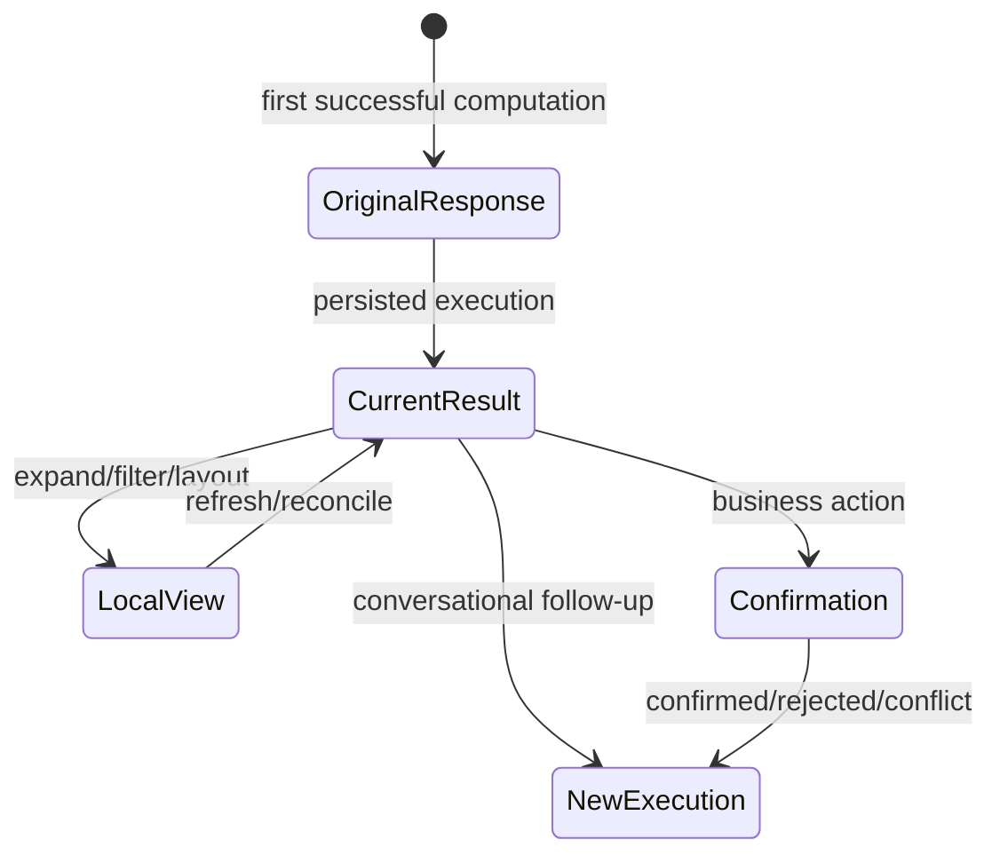

# Ask Cozy Presentation Architecture

## Verified current flow

```mermaid
flowchart LR
  U[Homeowner message] --> W[AskWorkspace]
  W --> API[Ask execution API]
  API --> C[createAskExecution]
  C --> R[Routing cascade]
  R --> O[ASK_OPERATION_DEFINITIONS]
  O --> H[capabilityInvoke / adapter handler]
  H --> D[Domain services and context providers]
  D --> AR[AskOperationResult]
  AR --> G[Trust validation and action finalization]
  G --> P[Persist AskExecution response]
  P --> B[BlockSequence / ASK_BLOCK_RENDERERS]
  B --> I[Local view, conversation, or business action]
  I -->|view only| VS[ResultView state]
  I -->|continue or mutate| C
  I -->|confirm| CF[confirmation handler + receipt/reconciliation]
```

## Stage ownership and contracts

| Stage | Owner | Input | Output | Error/recovery |
|---|---|---|---|---|
| Message composition | `AskWorkspace` | text, property/session context | execution request | client pending/error state |
| Intent/routing | routing cascade + operation registry | message and eligibility | `AskOperationResolution` | grounded guidance/boundary/clarification |
| Policy | operational controls + Skill policy | operation/user/property | allowed execution | blocked/unavailable result |
| Execution | capability handler registry | capability envelope | `AskOperationResult` | typed error/empty/limitation/boundary |
| Presentation validation | answer/trust validators | result + definition | allowed blocks/actions | disallowed content removed or safe failure |
| Persistence | execution lifecycle | current result | versioned `AskExecutionResponse` | retry/conflict/reconciliation paths |
| Rendering | block registry | discriminated block union | React UI | `UnsupportedBlock` |
| Local exploration | `ResultView`/view state | result identity + controls | filter/layout/detail state | reconciliation removes invalid stale ids |
| Durable action | typed dispatch + execution/confirm | declared operation/entity | new execution/receipt | visible unsupported/conflict/retry states |

## Presentation decision points

1. The **handler/producer** chooses narrative, block order, block payload, actions, tone, and optional presentation declaration.
2. The **operation definition** constrains which block types may survive trust validation.
3. The **frontend block registry** deterministically selects a renderer by `block.type`.
4. `GROUPED_LIST` may select a declared pattern (`STATUS_ACCORDION`, `SHELVES`, `DECK`, etc.) or a specialized block-id path.
5. Local view preferences change layout or disclosure only; they do not create a conversational turn.

The orchestrator does not choose React components, and the LLM does not determine UI structure. UI structure is typed and deterministic.

## State model

- `originalResponse` freezes the initial answer.
- `blocks` represent the current execution payload.
- `viewState.resultId` and revision identify an interactive result across refinements.
- browser storage retains bounded UI preferences only; response content is not stored there.
- business writes create execution/confirmation history rather than silently changing a historical message.

## LLM boundaries

Of 197 operations, registry inspection reports **196 deterministic** and **one `REMOTE_GENERATION`** operation. LLM use also appears in routing/extraction/synthesis subsystems, but the presentation renderer is not LLM-driven. Keep component selection, authorization, action eligibility, and status classification deterministic. LLM enhancement is appropriate for ambiguous intent, bounded extraction, explanations, and natural language—always with structured fallback.

## Coupling and duplication

- Strong centralization: operation registry, capability handler registry, block schema, renderer registry, action dispatch, result state.
- Distributed by design: domain judgment and action nomination live in handlers.
- Concentrated coupling: `GroupedListBlock` imports numerous domain result components and recognizes semantic meaning through fixed block IDs.
- Repeated producer work: answer summaries, limitation wording, collection truncation, and evidence/freshness annotations.

## Extension points

- Add shared optional semantic fields to existing blocks rather than new top-level blocks when the visual primitive already exists.
- Add a uniform collection-delivery contract and shared pagination/disclosure renderer behavior.
- Add producer-side answer-anatomy validation to the quality harness.
- Preserve old-response parsing and `UnsupportedBlock` fallback for additive evolution.

## Evidence

- Operation registry: `apps/backend/src/services/ask/askOperationRegistry.ts:25`, `:421`, `:624`.
- Capability invocation/validation: `apps/backend/src/services/ask/capabilityHandlerRegistry.ts:193`, `:240`.
- Response contract: `apps/backend/src/productFramework/ask/ask.contract.ts:1235` and frontend mirror `apps/frontend/src/features/ask/types.ts:57`.
- Renderer registry: `apps/frontend/src/components/ask/blocks/registry.tsx:48-90`.
- Interaction dispatch: `apps/frontend/src/features/ask/interactionDispatch.ts:31-51`.
- Result state: `apps/frontend/src/features/ask/resultViewState.ts:3-18`, `:72-109`.
